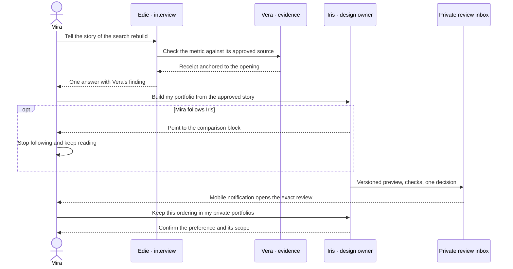

# How an AI team should work with someone

Market and interaction research for Eigenstory · November 2026

A person returning to an agent workspace should be able to tell **who is helping, what they can see, what changed, and whether anything needs a decision**. Shipped products demonstrate parts of that experience. Poe supplies distinct speakers, Figma demonstrates following a collaborator on a canvas, and GitHub and Replit make background work reviewable. The evidence supports borrowing those specific patterns. The five workflows below combine them into a proposed product design.

## How to read the evidence

The comparison uses first-party product documentation, platform and accessibility guidance, and primary HCI papers. A **documented feature** establishes what a vendor describes for a particular surface or mode. An **analogue** demonstrates a similar interaction in a different setting, such as following a person rather than an agent. A **prototype** supports findings about its study tasks and participants. The proposed defaults and tests are design hypotheses for Eigenstory. This was a documentation-based review, so availability, plan requirements, and actual behavior should be checked in the relevant build.

## 1. Several agents in one conversation

**The hard part is knowing who has the floor and who owns the answer.** Poe's creator docs give multi-bot messages a sender identifier. Claude Code's experimental Agent Teams supports a lead, independent teammate contexts, peer messaging, and a shared task list. Those are different capabilities. A product can let specialists coordinate with one another and still give the user one readable thread. Slack's agent design guidance supplies a useful vocabulary of short live status, durable updates, and artifacts. ChatGPT's group chats are a historical example and have since been retired. [Poe](https://creator.poe.com/changelog) · [Claude Code Agent Teams](https://code.claude.com/docs/en/agent-teams) · [Slack agent design](https://docs.slack.dev/concepts/agent-design/) · [ChatGPT retirement notice](https://help.openai.com/en/articles/12703475-retiring-group-chats-in-chatgpt)

Poe’s group chat is a direct desktop and mobile precedent. By default a person addresses a bot to trigger a reply, with optional automatic replies and per-chat mute. The help center also says that adding a person to an existing group chat exposes its history. Character.AI’s 2025 limited test explored the other end of the participation spectrum, with characters initiating turns with each other for roleplay. An Eigenstory project discussion can offer a deliberate comparison or brainstorming mode while keeping direct address and bounded contributions predictable in ordinary work. Show the audience change before inviting someone into a history that may contain private material. [Poe group chat and notification FAQ](https://help.poe.com/hc/en-us/articles/19944206309524-Poe-FAQs/) · [Character.AI’s limited test](https://support.character.ai/hc/en-us/articles/41760067000475-Community-Update-September-2025)

Research prototypes make participation an explicit variable. Chaves and Gerosa examine interactional coherence in single-agent and multi-agent settings. Clarke and colleagues compare automatic routing with asking users to select a speaker, in a 19-person pilot. Houde and colleagues study how people control agent participation during group ideation. Taken together, these motivate testing when a user wants deliberate specialist disagreement and when one person wants one useful answer. The studies support testing those choices in context. [Chaves and Gerosa](https://experts.nau.edu/en/publications/single-or-multiple-conversational-agents-an-interactional-coheren/) · [Clarke et al.](https://arxiv.org/html/2401.07123v1) · [Houde et al.](https://arxiv.org/abs/2501.17258)

**Eigenstory.** A question can go to the team or directly to Edie. By default Edie answers and owns the next step. Vera's finding appears as a small, attributed receipt anchored to the claim. Iris can speak directly when she has a design decision to explain. A separate comparison action invites both perspectives when disagreement is useful. Show the current recipient beside the composer. Apply the audience permission independently on every message and handoff.

## 2. The same agent across several projects

**An agent's identity and its permission to remember are separate.** ChatGPT documents project-only memory for shared projects, including exclusion of individual context outside that project. Claude documents a project memory layer with a separate account-memory control that can allow context across boundaries. Notion further distinguishes private personal Agent Memories from the grants that allow a custom agent to use workspace resources. These precedents give us more than one credible default. The choice matters most when someone brings a guest into a formerly private project. [ChatGPT Projects](https://help.openai.com/en/articles/10169521-projects-in-chatgpt) · [Claude Projects](https://support.claude.com/en/articles/9519177-how-can-i-create-and-manage-projects) · [Notion Agent Memories](https://www.notion.com/help/view-your-notion-agent-memories) · [Notion agent permissions](https://www.notion.com/help/custom-agents-sharing-and-permissions)

**Eigenstory.** Iris keeps her name, role, avatar, and interaction style. In a project she can see its drafts, permissions, and saved decisions. A user may also let her bring a personal preference, such as “show the working drawing before the finished room,” into another private project. The interview that produced that preference stays subject to its own grants. Before sharing a project, show who gains access and which notes, decisions, and pending tasks are included. Recheck access when a notification is opened and when a queued agent step reads or discloses data.

| Context | Iris can use | A collaborator can see |
|---|---|---|
| Mira's private portfolio | Portfolio sources and allowed personal preferences | Only what Mira deliberately shares |
| A new private application | Application sources and allowed personal preferences | Its own preview, if shared |
| A case study with a mentor invited | Project sources the agent is granted, with disclosure limited to the audience | Shared material and approved outputs |
| A temporary session | Inputs provided to that session, subject to the product's temporary-session policy | Nothing from it by default |

## 3. A character that occupies the canvas

**Presence earns its space when it directs attention to real work.** Figma's Spotlight demonstrates following a presenter and returning to individual control. That is a human collaboration analogue for a camera affordance. OpenAI's documented dot rollout illustrates a character as an assistant representation. ChatGPT Voice and Alexa guidance illustrate separate recording, mute, and privacy controls. A face can establish who is present, a pointer can identify what they are working on, and a capture indicator can report whether a device is recording. They should each tell the truth about their own state. [Figma Spotlight](https://help.figma.com/hc/en-us/articles/360040322673-Present-to-collaborators-using-spotlight) · [OpenAI dot](https://help.openai.com/en/articles/20001530-getting-started-with-your-dot) · [ChatGPT Voice](https://help.openai.com/en/articles/20001274-chatgpt-voice) · [Alexa privacy guidance](https://developer.amazon.com/en-US/alexa/voice-interoperability/design-guide/privacy-security)

Pointer Assistant tested proactive pointing in a budget-planning study with 220 participants. Sensible Agent examined how agents could choose when and how to show an intervention in staged AR scenarios. These studies suggest that embodiment can guide attention. Their settings leave open when a large cursor helps or gets in the way during a real work session. [Pointer Assistant](https://dspace.mit.edu/entities/publication/2d5afdd2-7d23-4773-bce2-1461d335b2f0) · [Sensible Agent](https://research.google/blog/sensible-agent-a-framework-for-unobtrusive-interaction-with-proactive-ar-agents/)

**Eigenstory.** Tapping Follow Iris makes her cursor conspicuous at the actual edit target and shows a persistent stop control. Use a semantic block ID so the pointer can land on the same element when the layout reflows. On a phone, a clear marker and jump link can carry the same meaning. With reduced motion, jump directly and use a static target highlight. Offer **Stop following** for the camera and **Pause work** for the agent's run. A replay uses recorded events with its own visible play state. [Apple HIG motion](https://developer.apple.com/design/human-interface-guidelines/motion) · [WCAG animation from interactions](https://www.w3.org/WAI/WCAG22/Understanding/animation-from-interactions.html) · [WCAG status messages](https://www.w3.org/WAI/WCAG22/Understanding/status-messages.html)

## 4. A specialist who can actually deliver

**Expertise shows up as decisions the user does not have to make and results they can inspect.** GitHub Copilot's agent workflow hands work back as a pull request. Replit's task board gives the user an isolated, reviewable result and labels that state “Ready.” Lovable treats publishing a snapshot as a distinct action. Cursor Automations and Devin's Slack integration show how assignment and progress can move outside the main editing surface. These are precedents for accountability, interruption, and release boundaries. A generated preview says the preview exists. A verified release must say what version reached which environment and what was checked there. [GitHub Copilot agents](https://docs.github.com/en/copilot/how-tos/copilot-on-github/use-copilot-agents/overview) · [Replit task board](https://docs.replit.com/features/agent/task-board) · [Lovable publishing](https://docs.lovable.dev/features/publish) · [Cursor Automations](https://cursor.com/docs/cloud-agent/automations) · [Devin in Slack](https://docs.devin.ai/integrations/slack)

Horvitz's mixed-initiative work weighs the cost of interruption against the cost of an incorrect action. Recent exploratory work on coding oversight examines how experienced developers supervise before, during, and after the job. Sidekick's prototype explores foreground interruption and how to help someone reenter a background task. The design implication is to ask about intent, consent, cost, or irreversible choices when necessary and provide inspection depth where the decision is made. [Horvitz](https://www.microsoft.com/en-us/research/wp-content/uploads/2016/11/chi99horvitz.pdf) · [Agentic coding oversight](https://arxiv.org/abs/2606.05391) · [Sidekick](https://arxiv.org/abs/2607.17527)

**Eigenstory.** Mira gives Iris an outcome, “Build a portfolio that makes my engineering decisions easy to see.” Iris owns layout, asset selection from authorized materials, responsive behavior, accessibility, and checking the build. She can ask whether a named customer may appear or whether Mira wants to publish a specific revision. The task record names Iris as owner, names the next actor separately, and links the preview, checks, version, and remaining decisions. “Ready to review,” “Approved to publish,” and “Live and verified” have independent meanings. After interruption, the next worker reads the same mandate and latest evidence before resuming.

## 5. Learning how a person works

**A good agent remembers something useful at the right level of generality.** ChatGPT documents memory sources and controls, with limits on how complete attribution may be. Claude distinguishes pausing memory from resetting it and distinguishes incognito from routine retention. Notion exposes private personal memories for inspection and editing. Gemini documents personalization from past conversations and offers Temporary Chat. Replika illustrates visible editable memories in a consumer relationship product. These controls are different enough that labels such as “forget” should state what happens to future retrieval and to the originating record. [ChatGPT Memory](https://help.openai.com/en/articles/8590148-memory-in-chatgpt) · [Claude memory and chat search](https://support.claude.com/en/articles/11817273-use-claude-s-chat-search-and-memory-to-build-on-previous-context) · [Notion Agent Memories](https://www.notion.com/help/view-your-notion-agent-memories) · [Gemini Temporary Chat](https://blog.google/products-and-platforms/products/gemini/temporary-chats-privacy-controls/) · [Replika Memory](https://help.replika.com/hc/en-us/articles/37208679176077-How-does-Replika-s-memory-work)

Generative Agents used observations and reflections to drive behavior in a simulation. LongMemEval tests retrieval, time, updates, and abstention across sessions. PrefEval tests whether a model follows previously expressed preferences. Those give product teams useful cases to test, such as a person changing roles or an old preference conflicting with a new instruction. UI comprehension, consent, and deletion propagation need their own evidence. [Generative Agents](https://arxiv.org/abs/2304.03442) · [LongMemEval](https://arxiv.org/abs/2410.10813) · [PrefEval](https://arxiv.org/abs/2502.09597)

**Eigenstory.** Keep separate records for what happened, what the user explicitly prefers, what the agent inferred, and which role is current. If Mira twice picks “start with the prototype,” Iris can ask at a natural moment whether to use that ordering on future portfolio projects. The user sees the proposed wording, scope, and source, and can choose this project, future private projects, or dismissal. A promotion or career change should supersede current-role context without rewriting the history of prior jobs. A review of past activity can propose a memory update. It has the same permission and confirmation rules as any other source. Improvements intended for all users belong in a separate program with its own data policy and evaluation.

## How it looks across surfaces

| Situation | Desktop or tablet | Phone | Asynchronous return |
|---|---|---|---|
| Two specialists contribute | One thread, attributed inline receipts, optional side-by-side comparison | Recipient beside composer, jump from receipt to block, full-width comparison when opened | One grouped inbox item for the question or result that needs attention |
| The same agent enters another project | Stable identity beside project name, inspectable context panel | Project name stays visible above the composer, tap for permitted sources | Deep link to the project and exact task, authorize again before showing details |
| The agent points or edits | Opt-in follow, local cursor and target, persistent exit | Stable block anchor, reduced-motion option and manual jump | Show a concrete change receipt, replay on request |
| An expert works unattended | Mandate, current checkpoint, preview and checks | One-line status and decision, evidence on demand | Notify on a material blocker or review-ready result, resume at the decision |
| A preference becomes durable | Show influence where it changed output and give it a home in editable memory | Inline “Remember for…” with one clear scope choice | Show a correction or expiry in the return summary when it matters to the task |

A notification is a door back into the work. It should survive duplicate delivery, old links, revoked access, and denied push permission. Use a privacy-safe lock-screen line such as “Your portfolio draft is ready for review.” The authenticated task view can name the project and display the actual decision. Cursor for iOS documents push and Live Activities for background agents. Apple and Android supply the platform guidance for interruption, privacy, and notification controls. [Cursor for iOS](https://cursor.com/docs/cloud-agent/mobile) · [Apple HIG notifications](https://developer.apple.com/design/human-interface-guidelines/notifications) · [Android notification design](https://developer.android.com/design/ui/mobile/guides/home-screen/notifications)

Replit's mobile documentation describes an Agent task area, Live Activities on supported Apple devices, and notifications when work needs help or finishes. GitHub Mobile documents pull-request review and notification triage. Both give desktop and phone a route to the same work, with different amounts of context at first glance. [Replit Mobile](https://docs.replit.com/features/platforms/mobile-app) · [GitHub Mobile](https://docs.github.com/en/get-started/using-github/github-mobile)

## One portfolio job from interview to review

The agent team can use the same event history for a small notification toast, a block-level annotation, a resume summary, and a full activity view. Those surfaces can differ in detail while referring to the same action, author, artifact revision, and access policy.

## What to test with people and what to verify in code

Run a formative comparison of a single lead with specialist receipts against a fully conversational team. Give participants a desktop task, interrupt it, and have them return on a phone. Include a shared project and a recently changed career preference. Ask for predictions before revealing the interface's answer. Track misattribution, unintended sharing, interruption recovery time, and whether the first user action reaches the intended place.

| Task | Evidence to collect |
|---|---|
| Resolve conflicting comments on one draft | The participant can identify who wrote each contribution, which agent owns the next move, and who sees the next reply. |
| Invite a collaborator while a background run is queued | The participant can predict what the collaborator can see. A system test verifies retrieval and disclosure under the new grants, including retries and cached summaries. |
| Follow Iris, stop following, and review the same edit on mobile | Camera control returns without pausing the run. Reduced-motion and keyboard paths reach the same block and communicate the same change. |
| Return to a review after the artifact changes | The participant can distinguish a private draft from a live release and sees that an old decision belongs to an older revision. A stale approval and duplicate delivery are rejected safely. |
| Change jobs, correct a remembered preference, and open a fresh project | The participant can explain why the new answer changed. A system test verifies that superseded context and revoked memory stop influencing the covered retrieval paths. |

Set a firm engineering requirement of zero unauthorized disclosures or repeated external actions in these scenarios. Set usability targets after a formative baseline and report the sample and conditions. Run the same scenarios with notification delivery disabled, screen-reader and keyboard interaction, reduced motion, short viewports, and slow or offline reconnection.

## Skills and when to invoke them

| Skill | Invoke when the design decision is about |
|---|---|
| [Multi-Agent Conversation UX](../skills/multi-agent-conversation-ux/SKILL.md) | Who speaks, who can read it, and how a person resumes or replies. |
| [Project-Scoped Agent Relationships](../skills/project-scoped-agent-relationships/SKILL.md) | What the same agent may carry between projects and what changes when the audience changes. |
| [Embodied Agent Presence UX](../skills/embodied-agent-presence-ux/SKILL.md) | Avatars, voice, cursor, camera, attention, and control in an interface or device. |
| [Expert Agent Delivery UX](../skills/expert-agent-delivery-ux/SKILL.md) | What a specialist owns, when it asks, what it delivers, and how completion is demonstrated. |
| [Longitudinal Agent Personalization](../skills/longitudinal-agent-personalization/SKILL.md) | How a working relationship adapts, how inferences become memories, and how people correct them. |

A multi-agent system will often use several of these skills on the same feature. Start with the failure being designed against. An agent pointing to the wrong shared object is a scope failure. A correct pointer that makes a reader lose their place is a presence failure. An agent saying the work is live while only a preview exists is a delivery failure.
