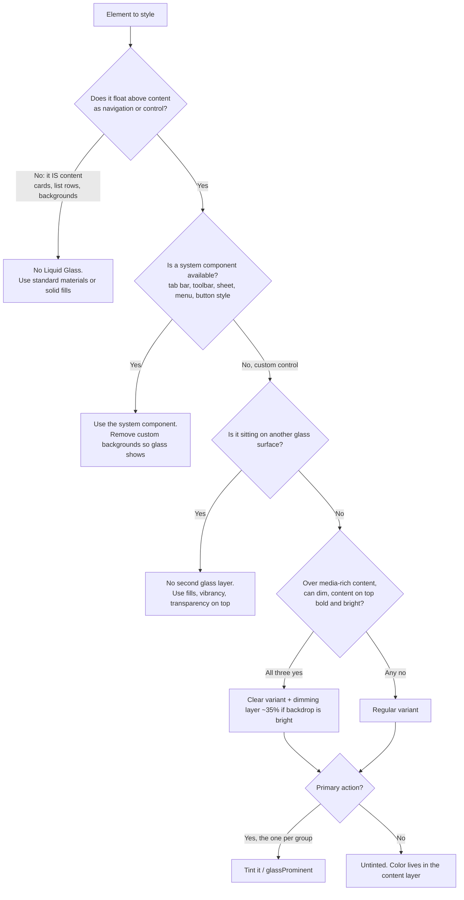

# Apple Liquid Glass Design

Liquid Glass is a **functional layer**, not a style. Apple's one-line definition:
"Liquid Glass is best reserved for the navigation layer that floats above the content
of your app" (WWDC25 *Meet Liquid Glass*). Every rule below falls out of that sentence.
Most bad Liquid Glass work is not a rendering bug; it is glass in the wrong layer.

## NOT for

- Generic frosted "glassmorphism" cards, vaporwave, or decorative blur → `vaporwave-glassomorphic-ui-designer`.
- visionOS window glass (unmodifiable system material, different rules).
- App icon layering / Icon Composer.
- Material 3, Fluent, or other non-Apple systems that merely look translucent.

## Source hierarchy

1. Apple developer docs and HIG (verify API names there; docs JSON lives at
   `https://developer.apple.com/tutorials/data/documentation/<framework>/<symbol>.json`).
2. WWDC25 sessions 219, 356, 323, 284, 310 and WWDC26 269, 251 (`references/sources.md`).
3. This skill's house heuristics (web numbers, perf budgets). These are labelled as house
   approximations; Apple publishes no blur radii or refraction constants.

Never invent an API. If a symbol is not in the docs JSON, say so and fall back.

## Decision 1: should this element be glass at all?

Exceptions Apple names: content-layer sliders and toggles become glass *transiently*
while being dragged; that is system behaviour, do not imitate it with permanent glass.

## Decision 2: which platform route

| Target | Route | Load |
|---|---|---|
| SwiftUI | System components first, then `glassEffect` in a `GlassEffectContainer` | `references/swiftui-recipes.md` |
| UIKit / AppKit | `UIGlassEffect` in `UIVisualEffectView`; `NSGlassEffectView` | `references/uikit-appkit-recipes.md` |
| Web, glass over your own WebGL/WebGPU canvas (maps, 3D, games) | **GPU post-process** inside the same pipeline | `references/web-gpu-postprocess.md` |
| Web, glass over static/slow DOM, few panels, showcase quality | ybouane/liquidglass library | `references/web-library-route.md` |
| Web, glass over ordinary DOM, broad reach, low effort | CSS `backdrop-filter` (+ SVG displacement in Chromium only) | `references/web-css-route.md` |

Full web decision tree with thresholds: `references/web-decision-tree.md`.

## The material in one table (what you are imitating)

| Property | Apple behaviour | Consequence for you |
|---|---|---|
| Lensing | Bends and concentrates light at the edges instead of scattering it | Edge refraction is the signature; centre stays nearly undistorted |
| Blur | Regular variant blurs and adjusts luminosity of what is behind | Light blur. Heavy blur is the old material, not Liquid Glass |
| Adaptivity | Small elements flip light/dark with the backdrop; large ones (sidebars, menus) do not flip and get more opaque | Do not hard-code a light or dark glass for small chrome |
| Shadow | Opacity rises over text, falls over solid light backgrounds | Shadow is a legibility tool, not decoration |
| Specular | Highlights follow geometry; light moves on interaction and device motion | One consistent light direction across all chrome |
| Size | Larger glass reads thicker: deeper shadow, more lensing, softer scatter | Scale effect strength with element size |
| Motion | Materialises by modulating lensing (not fading); morphs between controls; flexes and glows under touch | Animate refraction strength in, not opacity |
| Shape | Capsules, concentric corners, fixed radii only | Child radius = parent radius - inset |

Depth: `references/material-anatomy.md`, `references/shape-and-concentricity.md`,
`references/motion-and-interaction.md`.

## Non-negotiable rules

1. **Layer rule.** Glass only on the floating navigation/control layer. Content uses
   standard materials (`.thinMaterial`, `UIBlurEffect`) or solid fills.
2. **Never glass on glass.** Elements on a glass surface use fills, transparency and
   vibrancy. On web this is also a correctness bug: a `backdrop-filter` ancestor is a
   Backdrop Root, so nested glass samples only its parent, not the page.
3. **Regular by default.** Clear only when all three hold: over media-rich content, the
   content tolerates a dimming layer, and the symbols/labels on top are bold and bright.
   Bright backdrop under clear glass → dark dimming layer of about 35% opacity (HIG Materials).
   Never mix regular and clear in one group.
4. **Tint is emphasis, not decoration.** One tinted primary action per toolbar group
   (trailing side). Put brand color in the content layer. Tint the glass background, not
   the symbol, to mark a primary action.
5. **Group, then separate.** Glass elements near each other share one
   `GlassEffectContainer` / `UIGlassContainerEffect` / `NSGlassEffectContainerView`
   (single sampling pass, correct morphing). Do not group a text button with symbols.
   At most three toolbar groups.
6. **Concentric or capsule.** Nested corners share a centre: `r_inner = r_outer - inset`.
   Use `ConcentricRectangle()` / `.rect(corners: .concentric(minimum: 8))` in SwiftUI and
   `view.cornerConfiguration = .corners(radius: .containerConcentric(minimum: 8))` in
   UIKit instead of guessing. (WWDC25 beta spellings such as `.containerConcentric` /
   `.containerRelative()` were renamed before release; trust the docs.)
7. **Legibility is measured, not eyeballed.** Text on glass must hit WCAG 4.5:1 (3:1 for
   large text and glyphs) against the *rendered* pixels behind it, at the worst scroll
   position. Use `scripts/glass_contrast_check.py`.
8. **Accessibility settings win.** Reduce Transparency → frostier/opaque; Increase
   Contrast → predominantly black/white plus a contrasting border; Reduce Motion → no
   elastic morph, reduced effects. System glass does this automatically; custom and web
   glass must do it by hand. Safari has no `prefers-reduced-transparency`, so web apps
   need an in-app control as well.
9. **Scroll edge effects are not decoration.** Only where content scrolls under floating
   UI, one per view, soft for glass controls, hard for text/controls without backgrounds
   and pinned headers. Delete old custom bar backgrounds; they fight the effect.
10. **Web: the backdrop must be frame-synchronous.** Glass over an animated canvas is
    rendered in that canvas's pipeline, not by the DOM compositor. Dozens of
    `backdrop-filter` elements over a 144 Hz WebGPU canvas made fixed chrome visibly
    jitter on Mac Chrome; moving glass into the render pass fixed it.

## Workflow

1. **Classify every surface** into content layer vs control layer. Write it down as a
   glass spec (`templates/glass-spec.sample.json`, schema in `schemas/`).
2. **Strip** custom bar/sheet/popover backgrounds and decorative borders. Rebuild with the
   SDK and look at what the system gives you before adding anything.
3. **Adopt system components** (tab bar with search tab, toolbars with spacers, sheets with
   detents and zoom transitions, `.glass`/`.glassProminent` buttons).
4. **Add custom glass sparingly**, only for app-specific floating controls, in one container,
   with `glassEffectID` for morphs.
5. **Audit the spec**: `python3 scripts/audit_glass_spec.py spec.json`.
6. **Measure legibility** on screenshots at worst-case scroll positions, light and dark:
   `python3 scripts/glass_contrast_check.py shot.png --regions regions.json`.
7. **Toggle accessibility settings** (Reduce Transparency, Increase Contrast, Reduce Motion,
   and on 26.1+/27 the user's Liquid Glass look/tint control) and re-screenshot.
8. **Web only: profile** with the canvas animating at the display's native rate; check that
   chrome does not move relative to the scene (`references/web-decision-tree.md` gates).

## Failure modes (detect → fix)

| Failure | Detection rule | Fix |
|---|---|---|
| Glass in content layer | Glass on cards, list rows, page backgrounds | Standard material or solid fill |
| Glass on glass | Glass element whose ancestor is glass (spec `parent` chain; web: nested `backdrop-filter`) | Inner element becomes fill/vibrancy |
| Over-blur mud | Web blur > ~12 px at 1x, or backdrop unrecognisable; native: stacked `.ultraThickMaterial` under glass | Light blur plus edge refraction; let content show |
| Tint everywhere | More than one tinted element per group, or tinted symbols on a colorful backdrop | One primary, tint the background; color to content |
| Illegible text over busy content | p5 contrast < 4.5:1 (text) or < 3:1 (glyphs) in the checker | Regular variant, scroll edge effect, dimming, bolder weight, monochrome labels |
| Clear without dimming | `clear` over bright media, no dimming layer | Add ~35% black dimming or switch to regular |
| Pinched or flared corners | `abs(r_child - (r_parent - inset)) > 2 px` | Concentric shapes |
| Separate containers for neighbours | Adjacent glass in different containers | One container; spacing tuned |
| Web jitter over animated canvas | Chrome moves or shimmers relative to scene; many `backdrop-filter` layers over a high-Hz canvas | GPU post-process route |
| Ignored accessibility settings | Custom glass unchanged under Reduce Transparency / Increase Contrast / Reduce Motion | Implement fallbacks (`references/accessibility-fallbacks.md`) |
| Fake vibrancy | Grey text at fixed alpha on glass | System vibrant label colors / monochrome adaptive labels |

Full catalogue with root causes: `references/failure-modes.md`.

## Worked examples

- `examples/native-media-controls.md`: clear glass over video, dimming, morphing play/pause
  cluster, Reduce Transparency fallback (SwiftUI + UIKit).
- `examples/web-map-hud-jitter.md`: map HUD jitter from many `backdrop-filter` panels over a
  144 Hz WebGPU canvas; migration to an in-pipeline glass pass.
- `examples/web-marketing-nav.md`: static marketing page nav bar via CSS route with
  progressive enhancement and measured contrast.

## Quality gates (ship checklist)

- [ ] Every glass element is in the control layer; spec audit has zero errors.
- [ ] No glass-on-glass; neighbours share one container.
- [ ] Clear variant only where all three conditions hold; dimming present over bright media.
- [ ] At most one tinted primary action per group; content carries the brand color.
- [ ] Corners concentric or capsule; no hard-coded control heights.
- [ ] Contrast checker passes (p5 >= 4.5:1 text, >= 3:1 glyphs) light and dark, worst scroll.
- [ ] Reduce Transparency, Increase Contrast, Reduce Motion each verified by screenshot.
- [ ] Custom bar backgrounds removed; scroll edge effect only under floating UI, one per view.
- [ ] Web: route chosen by the decision tree; no DOM `backdrop-filter` over an animated
      canvas; frame time within budget at native refresh; WebGL context count recorded.
- [ ] Web: in-app transparency/contrast control exists because Safari lacks
      `prefers-reduced-transparency`.

## Resources

- `references/INDEX.md`: which reference to load for which question.
- `scripts/glass_contrast_check.py`: WCAG contrast of text against the pixels behind glass
  (stdlib only; optional blur/tint/dim simulation).
- `scripts/audit_glass_spec.py`: rule-based audit of a glass spec JSON.
- `schemas/glass-spec.schema.json`, `templates/glass-spec.sample.json`,
  `templates/contrast-regions.sample.json`, `templates/glass-tokens.css`.
- `diagrams/INDEX.md`: Mermaid decision diagrams.
- `agents/glass-reviewer.md`: subagent prompt for an independent Liquid Glass review.
