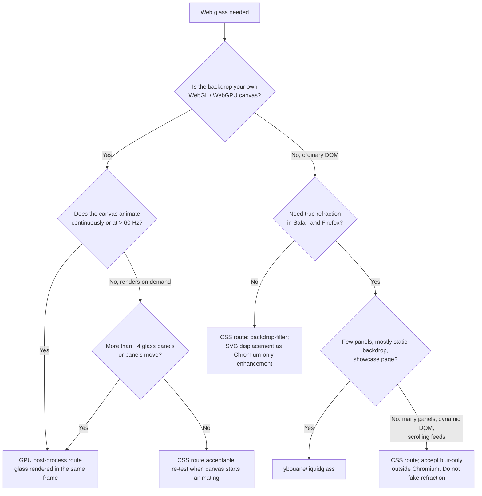

# Web: Choosing a Glass Route

The web has no Liquid Glass. You are imitating it, so the first question is not "how do I
make glass" but "who owns the pixels behind the glass, and how often do they change?"

## Route comparison

| | GPU post-process | ybouane/liquidglass | CSS backdrop-filter (+ SVG) |
|---|---|---|---|
| Refraction | Real, any browser with WebGL2/WebGPU | Real, WebGL1 | Chromium only via `url(#filter)`; blur elsewhere |
| Frame sync with an animated canvas | Exact (same pass) | No: captures/copies the canvas each frame | No: compositor readback, separate timing |
| Cost scaling | One blur chain per frame + O(pixels covered) | Per element: DOM rasterisation + its own WebGL context | Per element: backdrop readback + blur each frame |
| Text inside glass | DOM overlay on top (crisp, accessible) | DOM content inside glass element | DOM content inside glass element |
| Effort | High (you own a shader and rect sync) | Low | Lowest |
| Hard limits | Your pipeline | ~16 WebGL contexts per page, CORS images, fonts loaded before `init()` | Backdrop Root rules, Safari prefix history |
| Best for | Maps, 3D, games, data viz, video effects | Landing/showcase pages, few hero panels | Content sites, app chrome over DOM |

## Gates (fail any → change route)

1. **Frame budget.** At the display's native rate (6.9 ms at 144 Hz, 8.3 ms at 120 Hz,
   16.7 ms at 60 Hz), total GPU time for glass must stay under ~15% of the frame. Measure
   with Chrome DevTools Performance (GPU track) while the backdrop animates.
2. **Chrome stays put.** Record a screen capture at native rate while panning the canvas;
   fixed glass edges must not move or shimmer relative to the viewport. Any visible
   jitter over an animated canvas → GPU route.
3. **Context count.** Library route: count WebGL contexts (library + your app). Stay well
   under 16, or browsers start dropping the oldest.
4. **Backdrop Root.** CSS route: no ancestor of a glass element has `filter`, `opacity < 1`,
   `mask`, `clip-path`, `mix-blend-mode`, another `backdrop-filter`, or `will-change` on those,
   unless you intend glass to sample only inside that ancestor.
5. **Legibility.** Contrast checker passes at the worst backdrop (see `legibility-contrast.md`).
6. **Accessibility.** Reduce transparency / more contrast / reduced motion handled, plus an
   in-app toggle (Safari lacks `prefers-reduced-transparency`).

## House counts (heuristics, not standards)

- CSS route: up to ~6 simultaneous `backdrop-filter` regions over static/slow DOM is
  usually fine on a 2020+ laptop. Over an animated canvas, treat **any** count as suspect
  and **> 6 as a known failure** (the clay-map incident had dozens; see
  `examples/web-map-hud-jitter.md`).
- Library route: up to ~4 glass elements with static content; each `data-dynamic` child
  re-rasterises every frame.
- GPU route: panel count is nearly free (a uniform array of 16-64 rects); cost is dominated
  by the blur chain, which is constant per frame.
