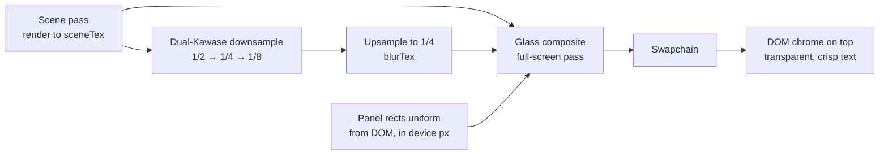

# Web GPU Route: Glass as a Post-Process Inside Your Pipeline

Use when the backdrop is your own WebGL2/WebGPU canvas (maps, 3D scenes, games,
generative backgrounds). The glass is drawn by the same renderer, in the same frame, after
the scene. DOM chrome (text, icons, hit targets) sits on top with a **transparent**
background and no `backdrop-filter`. Result: chrome and scene can never drift apart, and
cost no longer scales with the number of panels.

## Architecture



1. Render the scene into `sceneTex` (same size as the canvas backbuffer).
2. Build a blurred copy once per frame (dual Kawase: 2-3 down + 1-2 up passes at reduced
   resolution). Cost is O(screen) and independent of panel count.
3. Full-screen composite: pixels outside every panel copy `sceneTex` (plus panel shadows);
   pixels inside a panel run the glass shader.
4. DOM chrome is laid out with CSS as usual; its rects feed the panel uniform array.

## Rect sync (the part people get wrong)

```js
// Collect rects only when layout changes; never per frame for fixed chrome.
const panels = [...document.querySelectorAll('[data-glass]')];
let rectsDirty = true;
const ro = new ResizeObserver(() => { rectsDirty = true; });
panels.forEach(el => ro.observe(el));
addEventListener('resize', () => { rectsDirty = true; });
// For chrome that animates (sheets sliding), mark dirty during the transition.

function writePanelUniforms(device, buffer) {
  if (!rectsDirty) return;
  rectsDirty = false;
  const dpr = devicePixelRatio;
  const data = new Float32Array(MAX_PANELS * 16);
  panels.forEach((el, i) => {
    const r = el.getBoundingClientRect();
    const cfg = JSON.parse(el.dataset.glass || '{}');
    const radius = cfg.capsule ? Math.min(r.width, r.height) / 2
                               : parseFloat(getComputedStyle(el).borderTopLeftRadius);
    data.set([
      (r.left + r.width / 2) * dpr, (r.top + r.height / 2) * dpr,   // center
      (r.width / 2) * dpr, (r.height / 2) * dpr,                    // half size
      radius * dpr, (cfg.bevel ?? 12) * dpr,                         // corner radius, bevel width
      (cfg.refraction ?? 10) * dpr, cfg.chroma ?? 0.04,              // peak offset px, chroma
      ...(cfg.tint ?? [0, 0, 0, 0]),                                 // tint rgba (a = strength)
      cfg.clear ? 1 : 0, cfg.shadow ?? 0.18, cfg.fresnel ?? 0.18, cfg.specular ?? 0.28,
    ], i * 16);
  });
  device.queue.writeBuffer(buffer, 0, data);
}

function frame(t) {
  writePanelUniforms(device, panelBuffer);
  renderScene();          // into sceneTex
  renderBlurChain();      // into blurTex
  renderGlassComposite(); // to the canvas
  requestAnimationFrame(frame);
}
```

- Draw scene, glass, and update the DOM in the **same** `requestAnimationFrame` callback.
  Do not create the context with `desynchronized: true` (low-latency mode decouples the
  canvas from DOM compositing, which is exactly the drift you are eliminating).
- Use `getBoundingClientRect` (post-transform) and multiply by `devicePixelRatio`.
- Keep the DOM glass element's own background `transparent`; give it `pointer-events` and
  ARIA as normal. Text stays DOM text: selectable, crisp, accessible, zoomable.

## WGSL composite shader (WebGPU)

```wgsl
struct Panel {
  center: vec2f, half: vec2f,
  radius: f32, bevel: f32, refraction: f32, chroma: f32,
  tint: vec4f,
  clear: f32, shadow: f32, fresnel: f32, specular: f32,
};
struct Globals {
  size: vec2f, panelCount: u32, darkMode: u32,
  reduceTransparency: u32, increaseContrast: u32, _pad: vec2u,
  surface: vec4f,            // solid fallback colour (light or dark)
};
@group(0) @binding(0) var sceneTex: texture_2d<f32>;
@group(0) @binding(1) var blurTex: texture_2d<f32>;
@group(0) @binding(2) var samp: sampler;
@group(0) @binding(3) var<uniform> g: Globals;
@group(0) @binding(4) var<storage, read> panels: array<Panel>;

fn sdRoundBox(p: vec2f, b: vec2f, r: f32) -> f32 {
  let q = abs(p) - b + vec2f(r);
  return min(max(q.x, q.y), 0.0) + length(max(q, vec2f(0.0))) - r;
}
fn sdGrad(p: vec2f, b: vec2f, r: f32) -> vec2f {
  let e = vec2f(0.5, 0.0);
  return normalize(vec2f(sdRoundBox(p + e.xy, b, r) - sdRoundBox(p - e.xy, b, r),
                         sdRoundBox(p + e.yx, b, r) - sdRoundBox(p - e.yx, b, r)) + 1e-6);
}
fn luma(c: vec3f) -> f32 { return dot(c, vec3f(0.2126, 0.7152, 0.0722)); }

@fragment
fn fs(@builtin(position) pos: vec4f) -> @location(0) vec4f {
  let px = pos.xy;
  let uv = px / g.size;
  var col = textureSampleLevel(sceneTex, samp, uv, 0.0).rgb;

  // Shadows first (outside panels), so glass draws over them.
  for (var i = 0u; i < g.panelCount; i++) {
    let P = panels[i];
    let ds = sdRoundBox(px - P.center - vec2f(0.0, 2.0), P.half, P.radius);
    let s = (1.0 - smoothstep(0.0, 18.0, ds)) * step(0.0, ds) * P.shadow;
    col *= 1.0 - s;
  }

  for (var i = 0u; i < g.panelCount; i++) {
    let P = panels[i];
    let p = px - P.center;
    if (any(abs(p) > P.half + vec2f(1.0))) { continue; }      // cheap reject
    let d = sdRoundBox(p, P.half, P.radius);
    let cover = clamp(0.5 - d, 0.0, 1.0);                     // 1px AA edge
    if (cover <= 0.0) { continue; }

    let t = -d;                                                // depth inside, px
    let x = clamp(1.0 - t / P.bevel, 0.0, 1.0);                // 1 at rim, 0 past bevel
    let n2 = sdGrad(p, P.half, P.radius);                      // outward 2D normal
    let slope = x / sqrt(max(1.0 - x * x, 0.02));              // circular bevel profile
    let n = normalize(vec3f(n2 * slope, 1.0));

    // Lensing: displacement only in the bevel band, strongest at the rim.
    var refr = P.refraction * x * x;
    var chroma = P.chroma;
    if (g.reduceTransparency == 1u || g.increaseContrast == 1u) { refr = 0.0; chroma = 0.0; }
    let off = n2 * refr / g.size;                              // flip sign to magnify instead of wrap
    let blurMix = select(1.0, 0.25, P.clear > 0.5);            // clear: mostly unblurred
    var c: vec3f;
    for (var k = 0; k < 3; k++) {
      let scale = 1.0 + (f32(k) - 1.0) * chroma * 10.0;        // R, G, B at different offsets
      let suv = uv + off * scale;
      let sharp = textureSampleLevel(sceneTex, samp, suv, 0.0).rgb;
      let soft = textureSampleLevel(blurTex, samp, suv, 0.0).rgb;
      c[k] = mix(sharp, soft, blurMix)[k];
    }

    // Luminosity: regular glass lifts in light mode, deepens in dark mode.
    if (P.clear < 0.5) {
      c = select(mix(c, vec3f(1.0), 0.06), mix(c, vec3f(0.0), 0.10), g.darkMode == 1u);
      c = mix(vec3f(luma(c)), c, 1.35);                        // gentle saturation boost
    }
    // Tint mapped to backdrop brightness (coloured glass, not paint).
    let tinted = P.tint.rgb * (0.55 + 0.9 * luma(c));
    c = mix(c, tinted, P.tint.a);

    // Fresnel rim + specular from upper left with a faint opposite bounce.
    let fres = pow(1.0 - n.z, 3.0) * P.fresnel;
    let L = normalize(vec2f(-0.6, -0.8));
    let spec = (pow(max(dot(n2, L), 0.0), 6.0) + 0.35 * pow(max(dot(n2, -L), 0.0), 6.0))
               * pow(x, 3.0) * P.specular;
    c += vec3f(fres + spec);

    // Accessibility fallbacks.
    if (g.reduceTransparency == 1u) { c = mix(c, g.surface.rgb, 0.88); }
    if (g.increaseContrast == 1u) {
      c = g.surface.rgb;
      let border = 1.0 - smoothstep(1.0, 2.0, t);              // 2px contrasting border
      c = mix(c, vec3f(1.0) - g.surface.rgb, border);
    }
    col = mix(col, c, cover);
  }
  return vec4f(col, 1.0);
}
```

## GLSL ES 3.0 port (WebGL2) — differences only

```glsl
#version 300 es
precision highp float;
uniform sampler2D uScene, uBlur;
uniform vec2 uSize;
uniform int uCount;
uniform vec4 uPanelA[32];   // center.xy, half.xy
uniform vec4 uPanelB[32];   // radius, bevel, refraction, chroma
uniform vec4 uTint[32];
uniform vec4 uPanelC[32];   // clear, shadow, fresnel, specular
out vec4 outColor;
// sdRoundBox / gradient / luma identical; replace select(a,b,c) with c ? b : a,
// textureSampleLevel with textureLod, loops over uCount with a constant upper bound.
// gl_FragCoord.y is bottom-up: convert DOM rects with y' = uSize.y - y.
```

## Dual Kawase blur (GLSL, one down and one up step)

```glsl
// downsample: render at half the source size; uHalfPixel = 0.5 / sourceSize
vec3 down(sampler2D t, vec2 uv, vec2 hp) {
  vec3 s = texture(t, uv).rgb * 4.0;
  s += texture(t, uv - hp).rgb + texture(t, uv + hp).rgb;
  s += texture(t, uv + vec2(hp.x, -hp.y)).rgb + texture(t, uv - vec2(hp.x, -hp.y)).rgb;
  return s / 8.0;
}
// upsample: render at double the source size
vec3 up(sampler2D t, vec2 uv, vec2 hp) {
  vec3 s = texture(t, uv + vec2(-hp.x * 2.0, 0.0)).rgb;
  s += texture(t, uv + vec2(-hp.x, hp.y)).rgb * 2.0;
  s += texture(t, uv + vec2(0.0, hp.y * 2.0)).rgb;
  s += texture(t, uv + vec2(hp.x, hp.y)).rgb * 2.0;
  s += texture(t, uv + vec2(hp.x * 2.0, 0.0)).rgb;
  s += texture(t, uv + vec2(hp.x, -hp.y)).rgb * 2.0;
  s += texture(t, uv + vec2(0.0, -hp.y * 2.0)).rgb;
  s += texture(t, uv + vec2(-hp.x, -hp.y)).rgb * 2.0;
  return s / 12.0;
}
```

Two downs and one up land near a sigma of 6-8 CSS px on a 2x display, which matches the
regular variant. Reduce Transparency can sample a third, deeper level.

## Adaptive labels

Read back the panel's mean backdrop luminance (WebGPU: `copyTextureToBuffer` from a tiny
mip into a mappable buffer, `mapAsync`, accept 1-2 frames of latency; WebGL2: a PBO with a
fence). Apply hysteresis (switch to dark labels above 0.55, back below 0.45, at most every
150 ms) and toggle a class on the DOM element. The DOM labels are the only text; the shader
never draws text.

## Tuning notes

- Bevel 8-16 CSS px; refraction peak 6-14 CSS px; chroma 0.02-0.06. Scale with
  `clamp(sqrt(min(w,h)/44), 0.75, 2.0)` so large panels read thicker.
- Keep the centre undistorted. If the whole panel warps, your bevel is too wide.
- Interactive press: animate `refraction` and `specular` up by ~30% and the rect by 1.04x
  with a spring; skip under reduced motion.
- Materialize: animate `refraction` and `cover` from 0, not opacity.
- Glass-on-glass is impossible here by construction if each pixel takes the topmost panel
  only; keep it that way (break after the first hit when panels overlap).
