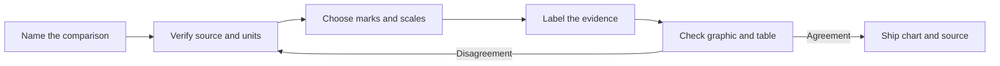

# Data Visualization

Build a chart around a decision the reader can make. Make the evidence visible in the marks, labels, and source notes.

## Start when

The task calls for a web chart, a data story, or a review of an existing graphic. Identify the audience, question, data source, unit, period, and intended comparison. Inspect the data and its missing values before selecting an encoding. Use labeled demonstration data if the source is unavailable and a prototype still advances the task.

## Stop when

- **Complete** when the chart and readable data alternative agree with the source, the intended comparison works at narrow and wide widths, and the delivery includes the chart files, source and actual verification. Check all plotted values for small data, or assert the transformation and verify representative edges for large data.
- **Handoff** when a named consumer receives the chart or code, data schema and source, scale choices, expected output, and its first acceptance check. Identify any assumptions the consumer must confirm before publication.
- **Blocked** when a missing source, ambiguous denominator, or labels that cannot be verified would make the result misleading. Record the missing condition. Keep an explicitly labeled fixture or draft if it helps.

## Make the comparison legible

| The reader wants to know | Start with | Verify |
| --- | --- | --- |
| Which category is larger | Ranked horizontal bars or aligned dots | Use a zero baseline for lengths. Keep labels readable. |
| What changed over time | A line or points on a time scale | Show gaps as gaps. Use a meaningful reference and label the units. A line may use a nonzero domain when the context is clear. |
| How several groups compare | Small multiples with shared scales, or a directly labeled overlay for a few related series | Use comparable domains and the same time extent. Keep individual labels with their series. |
| How values are distributed | Dot plot, histogram, or interval plot | Explain bins, sample size, and exclusions when they matter. |
| What a single value means | A small table or a number with a sparkline beside it | Show the unit, comparison period, and source. |

## Design and build the chart

1. **Write the question and check the data.** Note denominators, time zones, missing values, uncertainty, and any filter that changes the population. Compute the headline from the same transformed data as the chart and table.
2. **Choose position, then choose a tool.** Prefer aligned position and length for precise comparisons. Start with the project's chart library if it supports the needed marks and access patterns. Use [Observable Plot](https://observablehq.github.io/plot/features/marks) for layered marks and shared-scale facets, D3 for a custom coordinate or interaction, and a semantic table when exact lookup is the main need. Profile real data and interaction before changing renderers.
3. **Make a quiet frame and a clear point.** Use typography to separate the finding, unit, axis and source. Put short labels close to their marks. Add an honest baseline or reference line and an annotation that helps a decision. Choose a restrained highlight and encode meaning with position, text, or shape as well as color.
4. **Keep the comparison at smaller widths.** Change label placement or stack panels before changing the data. If you aggregate, choose and explain the aggregation so the reader understands the change. Never silently drop series on mobile. Keep equivalent keyboard or visible table access to values.
5. **Check the delivered artifact.** Verify zero, negatives, null, empty data, and long labels when relevant. Test at 320 px, a wide viewport, and enlarged text. Read the output without hover or with a screen reader. Check its values and source note against the table and fixture. Handle loading and error states only where the data is asynchronous.

## Avoid these failures

- **A false difference.** Truncated bar lengths amplify differences. Use zero for bars. If the question concerns a small change, try a directly labeled dot or line chart with a clear domain and reference instead.
- **A missing period turned into a connection.** A line across a gap suggests data the chart does not have. Split the line, and give the reason if the source documents it.
- **A tiny legend and a pile of series.** Label a few lines directly or use shared-scale small multiples. Keep the full view and offer the table for exact lookup.
- **A beautiful chart that only works on hover.** Put the main comparison on the chart itself. Offer data as text and expose any filters or drill-downs with keyboard access.

## Example asset

The [editorial chart asset](assets/example-chart.tsx) shows three parallel time series using a common scale. It includes a missing measurement, plain language annotations, and a table of the same underlying values. [Styles](assets/example-chart.css) set the type hierarchy and support both light and dark appearance. Its fixture is explicitly illustrative.

## References

- [Data storytelling](references/data-storytelling.md) when the chart needs a clear headline and narrative.
- [Library comparison](references/library-comparison.md) when selecting or replacing a chart engine. Confirm current library behavior before using a cookbook snippet.
- [Tufte principles](references/tufte-principles.md) for graphic integrity and dense readable comparisons.
- [Testing strategies](references/testing-strategies.md) for a reproducible browser and data check.
- [Animation patterns](references/animation-patterns.md) when a transition explains the change the user just made.
- [Data transformations](scripts/data-transform.ts) when records must be grouped or summarized.
- [Authored matching requests](references/tool2vec-queries.json) when updating the WinDAGs search vector.

Edward Tufte’s [small, consistently scaled graphics](https://www.edwardtufte.com/notebook/sparkline-theory-and-practice-edward-tufte/) inform the comparison. Mike Bostock’s [reusable chart design](https://bost.ocks.org/mike/chart/) and Observable Plot’s [facets](https://observablehq.com/plot/features/facets) inform how the example separates data, scales, and marks. Use [21st.dev component previews](https://21st.dev/community/components/s/analytics) to inspect useful interaction patterns. Check the license and evaluate the result with your own data and keyboard tests before reuse.
