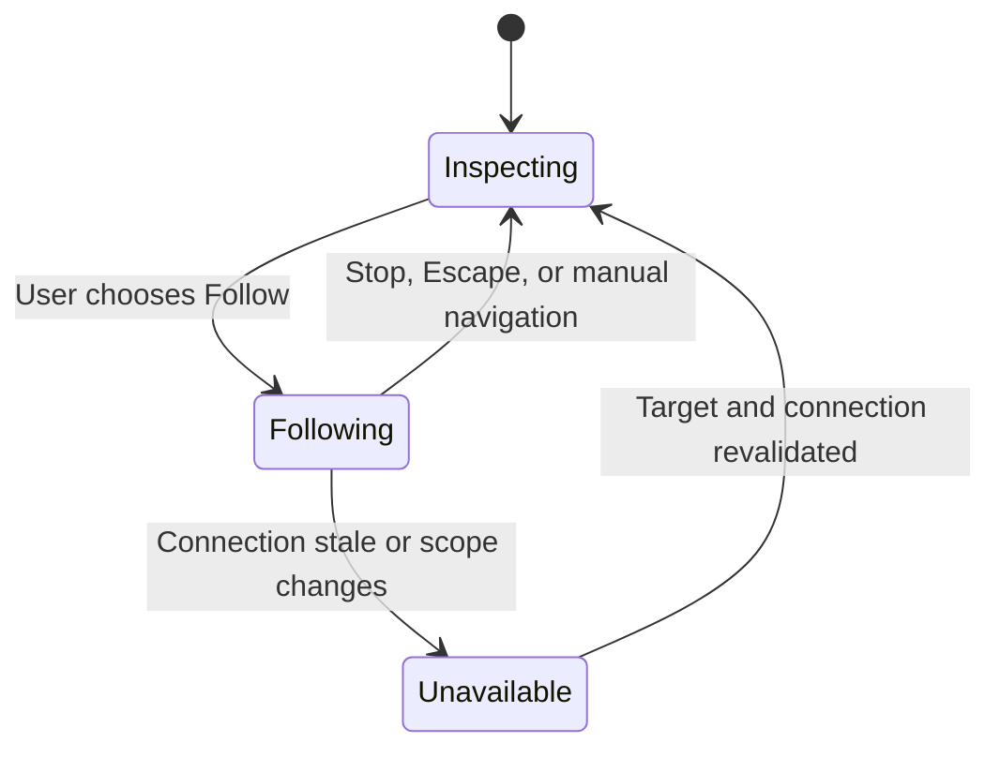

# Embodied agent presence UX

Use this skill when an agent needs to show where it is working or what it needs from the user. Start with identity, a truthful status, and one next action. Add an avatar, cursor, voice, or movement when it makes that action easier to understand.

## Choose the smallest presence that helps

| User need | Use | Keep within reach |
| --- | --- | --- |
| Know who made a change | Named avatar and a receipt attached to the changed artifact | Open change or undo if supported |
| Understand where an agent is working | Visible marker at a stable document or canvas anchor | Jump to the anchor without following |
| Observe a sequence of edits | Explicit, reversible viewport follow | Stop following from the viewport |
| Edit alongside the agent | Independent pointers and clearly labeled ownership | Pause the run or take control, when supported |
| Speak while hands are busy | Visible microphone state, captions, and an interruptible voice | Mute mic, stop speaking, and end voice |
| Return to a consequential event | One asynchronous notification tied to the event | Deep link to its current state and permission check |

An avatar identifies an actor. Its appearance alone never indicates a connection, microphone activity, a running task, a permission grant, or a successful change. A pending operation earns a pending label. Use a success label after the system has verified a result.

## Separate observation from authority

Track the actor, run state, viewport state, control owner, and capture state independently. For example, “Following Iris” describes your viewport while “Iris is applying the preview theme” describes the run. Stopping follow leaves the task running. Taking over changes the operation’s owner only after the system acknowledges it.

Build the exit before adding motion. Follow applies only to the current document or workspace. It never steals focus and never resumes on its own after reconnect. Use an equivalent stationary target indicator for reduced motion and for users navigating by keyboard or screen reader.

## Build and review

1. Identify the decision or action that visible presence helps the user make. Describe the behavior for desktop, mobile, and return from background.
2. Draw the independent states and name the source of truth for each. Design the offline, interrupted, and stale states alongside the happy path.
3. Make the cursor decorative and place the meaningful label and Jump action in the document or controls. Resolve the target by artifact version and stable anchor.
4. Separate microphone capture, audio playback, run pause, and execution takeover. Provide only the controls supported by the current state and permissions.
5. Test with keyboard, screen reader, reduced motion, small phone, stale events, reconnection, denied capture, and interrupted actions. Measure whether users can tell who acted, what changed, and how to regain control.

## Read when needed

- [Market and research evidence](references/market-evidence.md) when choosing a metaphor or citing why it might work. It separates product documentation, research prototypes, and application to Eigenstory.
- [Interaction contract and evaluation](references/interaction-contract.md) when writing events, designing state transitions or notification behavior, building a prototype, or testing activation.
