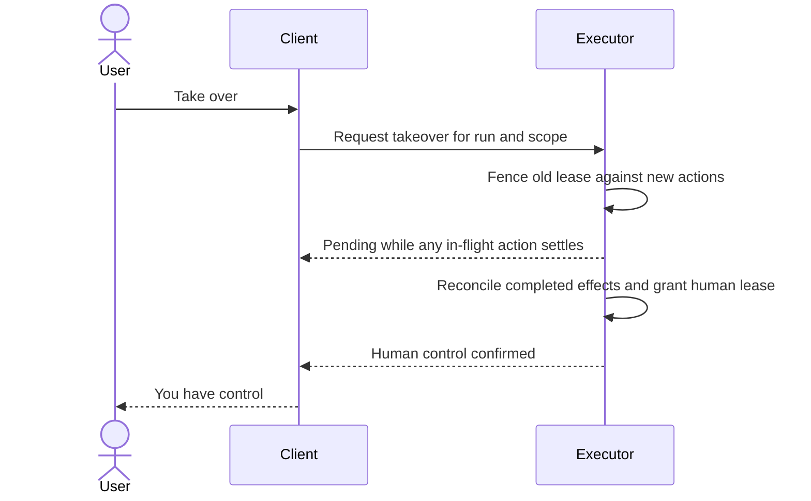

# Interaction contract and evaluation

## Give each signal one source of truth

| Lane | Example values | Authority |
| --- | --- | --- |
| Identity | Actor ID, name, avatar, human or AI, current role | Actor registry |
| Connection | Current, stale, disconnected, last verified time | Connection and heartbeat tracking |
| Run | Queued, running, waiting for you, pausing, paused, succeeded, failed | Run coordinator or verified artifact receipt |
| Viewport | Inspecting, following, unavailable | Local client |
| Execution | Agent, human, takeover pending | Executor holding the current fenced lease |
| Media | Mic, camera, screen capture, and output playback tracked independently | Capture and playback APIs |
| Example playback | Ready, playing, paused, ended | Playback controller, isolated from live events |

A receipt can store the actor, committed artifact version, and undo capability. Its author remains identifiable after the session ends. A connected agent may have no active run. A disconnected client may rejoin a still-running task after retrieving current state.

Example event contract, transport agnostic

```yaml
event_id: evt-190
actor_id: iris
scope: project-8
run_id: run-27
stream: presence
sequence: 31
source: live
kind: target-changed
occurred_at: "2026-01-15T12:30:00Z"
target_ref:
  surface: case-study
  artifact_version: rev-52
  anchor: opening-paragraph
```

Authorize both subscriptions and target access. Keep ordering per stream and producer run. On reconnect, load a current snapshot, then accept newer sequences within the active scope. Ignore duplicate, expired, and wrong-scope presence events. Tune presence expiry to heartbeat cadence, and expose the last verified time if it matters. Use durable receipts for edits, approvals, and results. Keep sample replay events in a separate source and reducer so an example can never switch live state or send a notification.

## Make following reversible

1. Resolve the surface and stable anchor in the correct artifact version. Recompute local bounds on zoom and reflow. When no matching anchor exists, show “Location unavailable” with a link to the artifact, if accessible.
2. Start following from an explicit action such as “Follow Iris.” Keep “Stop following” reachable in the same viewport. User-initiated scrolling, zooming, or editing releases the camera, as does Escape, scope change, or stale connection. Passive pointer motion can leave follow active. Treat “Stop following” as local to the viewport.
3. Present a pointer visually only. Give it `pointer-events: none` and hide the decoration from assistive technology. Pair it with an independently focusable action such as “Jump to Opening paragraph” and a textual status. Do not change focus when camera moves. With reduced motion, show a stationary anchored highlight and explicit Jump. Honor the stricter of the OS or in-app motion settings.
4. For execution takeover, request authority through the executor, invalidate the prior lease, and reject future actions carrying its epoch. Acknowledge once ownership changes. If a started effect cannot be canceled, say it is finishing and show its verified result before promising control. Returning control requires an explicit action and the current artifact version.



## Voice, spatial hardware, and asynchronous return

- Keep mute microphone, silence playback, stop speaking, and end voice semantically distinct. Use barge-in only when the runtime supports it. On interruption, invalidate the current utterance before playing any further audio. Preserve finished text as such and label partial text appropriately. Keep one audible speaker by default and identify the recipient of captured speech. Only enable background capture when a user has explicitly enabled it and persistent capture status is available.
- For AR, projection, and physical devices, tie the cue to verified tracking and a clear target. On tracking loss, stop spatial guidance and provide a stationary text or device-native fallback. Show capture or movement only when signaled by the relevant device. Reserve emergency-stop claims for systems that implement and verify that behavior.
- Send a notification for a useful state transition such as “A preview is ready for review.” Progress and presence remain in the active workspace or digest. Use an event identifier to deduplicate deliveries. Keep sensitive project details out of lock-screen previews by default. Open to the latest authorized destination after unlock. If the decision was already made or access has changed, show the current state instead of replaying the old action.

## Worked example

Edie points to the opening paragraph of Mira’s case study and asks a question. The prompt offers “Jump to Opening” and has a visible avatar and accessible name. On a phone, Jump scrolls directly to the paragraph with a clearly marked inline reply and leaves the keyboard closed until the user activates the input. With reduced motion, the paragraph receives a static highlight. An unfinished private reply is neither copied into a notification nor used as a public annotation.

Iris generates a new preview. A wide-screen user chooses Follow Iris and sees a labeled canvas edge and a clear Stop following control. If the user scrolls to check a different section, follow releases and the preview generation continues. When the preview is verified, the receipt links to its revision. A later mobile notification opens that revision or its current review state after checking access. The sample version labels its timeline “Playing example” and uses the same visual identity with separate playback controls.

## Acceptance and failure tests

| Test | Observable result | Failure signature |
| --- | --- | --- |
| Follow, then scroll or press Escape | Camera stops following and the run state stays the same | Scrolling fights the user or a local view action cancels work |
| Switch project during follow and reconnect | Prior target vanishes and follow requires a fresh gesture | Cross-project cursor, jump, or notification leaks context |
| Deliver out-of-order and repeated target events | Latest valid in-scope target stays active | Cursor walks backward or resurrects an old run |
| Resize, reflow, and remove the target | Marker follows the valid anchor or shows it is unavailable | Marker points at the same coordinate in a different block |
| Race a takeover against an in-flight operation | Pending remains visible until the operation settles and ownership is acknowledged | Early success label or writes accepted from the revoked epoch |
| Deny mic access, then interrupt playback in an allowed session | Mic stays off when denied and stopped audio does not resume | Capture animation lies or a canceled voice reply comes back |
| Try reduced motion, keyboard, and screen reader | Static target and Jump work, focus stays put, meaningful status is announced once | Involuntary pan, keyboard trap, or every pointer frame announced |
| Check 320px width, 200% text, and short landscape | Labels remain legible and Stop following is reachable | Avatar or sticky bar obscures the exit or the reply |
| View notification on lock screen, then revoke access | Generic preview and safe landing without private data | Client name, project text, or an actionable revoked link leaks |
| Pause an example while live work is active | Only example playback pauses | Sample controls change real execution state |

A novice implementation often uses color or glow as the only clue. Test with the animation and avatar hidden. An expert implementation can still conflate a tool’s accepted request with a completed effect. Inject a late acknowledgement, disconnect, and duplicate to see whether the user ever gets a false success or a stale handoff. In usability tests measure correct attribution, time to regain control, missed decisions, and interruptions participants consider unwanted. Compare those outcomes across phone, desktop, and accessible alternatives.

## Activation probes

| Activate for | Leave to another skill |
| --- | --- |
| “Make Iris point at the hero she is restyling and let me follow.” | “Choose a cheaper model for Iris.” |
| “Show when the room assistant is really listening and let me interrupt it.” | “Summarize 200 turns into long-term memory.” |
| “Give an agent a physical presence in a shared workspace, with an immediate user exit.” | “Decide which of eight specialists owns a proposal.” |
| “Handle a review-ready mobile notification when the agent is off screen.” | “Build a general transactional email delivery service.” |
| “We need a camera-lock prototype that still works with reduced motion.” | “Draw an illustration of our agent mascot for the blog.” |
