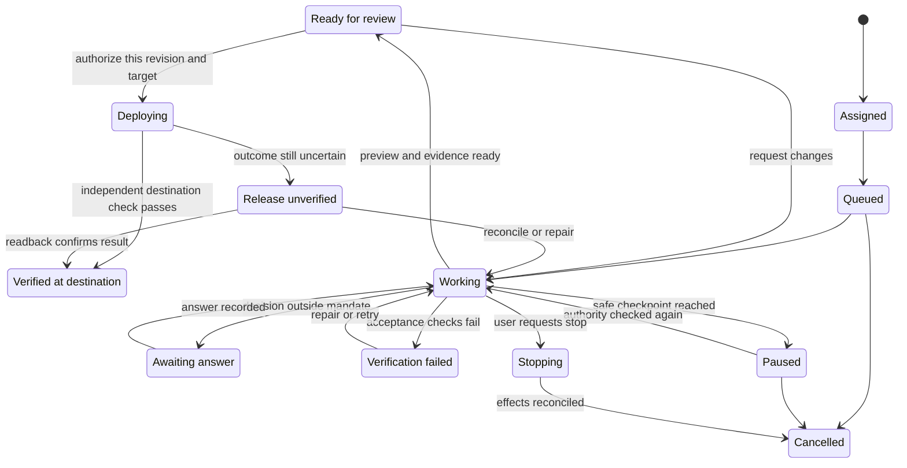

# Expert agent delivery UX

Give one named specialist ownership of a deliverable. Let the specialist make and explain professional decisions within a visible mandate. Let the user decide the outcome, audience, business constraints, and effects that require their authority. Keep the current owner and next actor visible even when they are different.

## Design the handoff

1. **Start with the assignment.** Show the specialist, promised deliverable, target audience, access boundary, completion criteria, and the next decision that might need the user. Use one optional disclosure for the technical plan. Turn “Make me a complete site” into a short proposal such as “I’ll build and test a private preview. I’ll ask before making it public.” Choose and document reversible implementation defaults. Ask a single recommended question when an unresolved goal, unavailable input, or external effect would materially change the outcome.
2. **Let the user leave.** Persist a task ID and show who is working, the latest durable checkpoint, and a meaningful next milestone. Give queued work a reason when it is known. Provide pause and cancel with clear consequences for work already underway. Keep routine operations in a drill-down activity log and put material blockers in the task inbox. Distinguish stopping from stopped while an effect is still in flight.
3. **Review a specific version.** Lead with the result and an inspection path. Provide the preview, what changed, and which acceptance checks passed, failed, or could not run. Put raw logs behind the proof they support. Bind evidence and approvals to the reviewed revision, target environment, and effect. Keep comments anchored to that revision and allow users to compare or request changes.
4. **Separate approval from verified delivery.** Make the action explicit, such as “Publish version 3 to example.com”. Independently check that the approved revision reached the intended target and works there. Keep “Release unverified” distinct from “Live and verified”. Offer the recovery action the effect actually supports and verify the outcome of recovery too.

The diagram models a publishable deliverable. For a private handoff, use “Delivered” once acceptance passes and the requested artifact is available. For preauthorized work, record the policy and scope that granted the effect, then retain the same evidence and destination check.

## Make the task readable across surfaces

| Surface | First thing the user needs | Interaction |
|---|---|---|
| Desktop workspace | Owner, task state, and what changed | Compare exact versions side by side. Keep action receipts and evidence near the result. |
| Mobile task detail | Result or the decision waiting on them | Start with an artifact preview and one primary action. Keep compare, test details, and history one disclosure away. Restore scroll and focus when returning. |
| Notification or team thread | Why attention is needed | Send a concise, deduplicated event for a real decision, blocked work, or delivery according to preference. Deep link to the exact task in the authenticated app. Keep private content out of lock-screen copy. |
| Return after absence | What happened and what is expected now | Show the latest durable checkpoint, approvals, unresolved blockers, and the next available action. Announce material state changes accessibly and retain a visible status. |

## Anti-Patterns

### Approval follows the reviewed revision

**Novice.** Reuse an approval after edits, or let a stale push notification approve the newer artifact.

**Expert.** Open the reviewed revision and recheck authorization at the action boundary. If the revision, target, or material effect changed, show the difference and obtain new authorization.

**Timeline.** Version 3 is reviewed → version 4 changes the contact destination → the version 3 approval cannot authorize version 4.

**Detection.** A stale mobile review link opens the latest revision with “Publish” enabled and no new authorization.

### Other failure patterns

- **Novice.** “Choose a framework, a database, and a deployment provider before I can start.” **Expert.** Propose a tested private preview using reversible defaults. Ask about constraints the user actually owns, such as where submissions may go or whether the site may be public.
- **Novice.** Send a running feed of tool activity, then notify “Done” when the last command returns. **Expert.** Show a durable milestone as work happens, notify when there is something to review, and issue a separate receipt after destination verification.
- **Novice.** Label a local checkpoint “Undo” after an email or external change. **Expert.** Show exactly what can be restored or compensated and which effects already happened.
- **Novice.** Present the producer’s “looks good” as proof. **Expert.** Attach a verifier’s observed results tied to the revision and environment. Leave unrun checks visible and make their consequences clear.

## Validate the design

Ask participants to assign a full deliverable, leave, return on mobile, review a changed revision, and recover from a failed or interrupted release. Include a novice who cannot assess implementation choices. At every stage, check whether they can explain who is working, what the agent may do, whether the result is public, what was actually verified, and what their next action will do. Test long-running work with disconnected clients, stale deep links, denied permissions, no push permission, duplicate events, and reduced motion or a screen reader.

## Handoff

Deliver the assignment and authority contract, lifecycle, desktop and mobile review paths, notification triggers, and acceptance drill. Record how verification and recovery appear to the user, including one blocked decision and one uncertain release outcome.

## Read next

- Read [Delivery contract and failure cases](references/delivery-contract.md) when writing a mandate, interaction spec, acceptance test, or event contract.
- Read [Market and research evidence](references/evidence.md) when comparing patterns or making claims about a product, platform, or study.
- Read [Activation examples](references/activation.md) when checking whether this skill covers a prompt or calibrating routing.
- Read the [Changelog](CHANGELOG.md) when reviewing the scope of a skill release.
