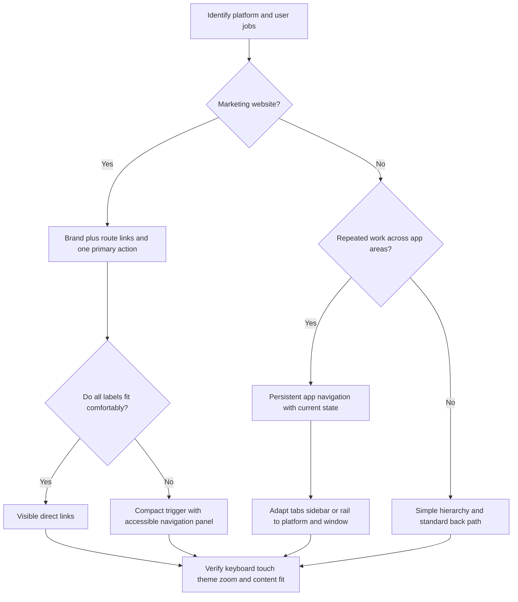

# Navigation and Wayfinding

Load before designing or repairing global headers, footers, route hierarchy,
mobile menus, app chrome, or product showcases. Use the gallery only when
selecting references. Research checked 2026-10-25; revalidate sources before
copying a component or applying changing platform APIs.

## Start with destinations and jobs

Inventory real routes and the jobs they serve: explore work, evaluate an offer,
use a product, obtain support, contact the operator, and understand privacy.
Record each route's label, owner, audience, availability, primary/secondary
priority, and location in the shell. Use one typed content model where possible.
Do not invent pricing, status, newsletter, social, legal, or login destinations
because a template has space for them. Separate sales contact from product help.

Ask an unfamiliar reader where each label leads. Prefer literal labels over
internal terminology. Preserve deep links, filtered list state, and browser Back.
Do not equate more visible links with a more understandable hierarchy.

## Choose the pattern before the effect

| Context | Appropriate structure | Avoid importing blindly |
| --- | --- | --- |
| Marketing website | Branded home link, concise primary route links, one main conversion, grouped footer utilities | App command menus, icon-only docks, sign-in controls without an app |
| Web application | Persistent current area, meaningful page title, tabs/sidebar when tasks warrant them, contextual actions | Marketing megamenus or a giant commercial footer inside a working surface |
| Apple native app | System tab/sidebar adaptation for top-level areas; navigation stack and standard Back/Close; toolbar for commands | A web header/footer reproduced as a native screen |
| Android/Material app | Adaptive navigation bar/rail based on window class/posture; app bars and contextual actions | One phone navigation layout stretched across every window |

Native guidance informs the crosswalk; this web skill does not implement native
apps. Hand native execution to an appropriate platform skill. Consult current
[Apple tab bars](https://developer.apple.com/design/human-interface-guidelines/tab-bars),
[sidebars](https://developer.apple.com/design/human-interface-guidelines/sidebars),
[toolbars](https://developer.apple.com/design/human-interface-guidelines/toolbars),
and [Android adaptive navigation](https://developer.android.com/develop/ui/compose/layouts/adaptive/build-adaptive-navigation).
The Android adaptive suite chooses a bar for compact width/height or tabletop
posture and a rail otherwise; it responds to runtime window changes. Keep
selection/state continuous across presentations. Do not universalize one old
bar/rail/drawer breakpoint recipe.

## Compact header, durable identity

- Treat the logo/wordmark home link as an atomic brand unit. Its letters must
  never wrap, split, collide, or be clipped. A bounded logo footprint is distinct
  from freezing navigation/body text to suppress enlargement.
- Define component role tokens for shell height, brand width, gaps, targets,
  borders, surfaces, active state, focus, and responsive thresholds. Measure with
  the actual font and labels, including long translations.
- Collapse the link inventory before it collides. Do not let a normal mobile
  header become several rows of brand, menu, preferences, and competing CTAs.
  Record a normal-text height budget appropriate to the page; grow safely when
  accessibility needs require it rather than clipping a fixed-height bar.
- Choose one visual primary action. Keep identity, route navigation, and utility
  controls in recognizable groups. Mark the current destination in text/shape
  and semantics, not color or glow alone.
- Prefer a stable in-flow shell unless persistence helps the user. Sticky or
  shrinking headers must prove anchor offsets, visible focus, no layout jump,
  and usable short viewports. Do not hide essential routes solely on scroll.
- Preserve the authored brand font/features. Large swashes can carry identity;
  multiple enormous display labels can bury the offer and are not hierarchy.

## Mobile menu behavior

Ordinary website links belong in semantic navigation, not application-style
`menu`/`menubar` roles by default. A disclosure uses a button with expanded state
and a controlled link region. Direct destinations remain anchors. Do not make
hover the only way to open or reach a destination. Follow the
[WAI disclosure example](https://www.w3.org/WAI/ARIA/apg/patterns/disclosure/examples/disclosure-navigation/)
and [web.dev navigation guidance](https://web.dev/learn/html/navigation/), then
test the actual implementation rather than treating examples as certification.

If the mobile panel blocks the page, use the existing accessible dialog
primitive: meaningful name, initial focus, close control, Escape, focus
containment, inert background, scroll lock and restored trigger focus. Follow
[WAI modal dialog behavior](https://www.w3.org/WAI/ARIA/apg/patterns/dialog-modal/).
A nonmodal panel must not pretend to be modal or trap focus unnecessarily.

Keep all destinations available after collapse. Ensure the close control and
last link remain reachable in short landscape windows, with keyboard open and
safe-area insets. Let the panel scroll independently when necessary. Close on
route selection; test reopening and resize while open. Hidden duplicates must
not remain in the focus order. Retain a coherent source/tab order across sizes.

## A footer is a useful destination map

Group a real route inventory with visible labels: for example, product routes,
working with the company, company/resources, and legal/help. Use only the groups
the inventory warrants. Include accountable identity and an actual contact/help
path. Appearance, motion, copyright, and legal utilities belong in a stable
final layer. Do not invent social links, a subscription handler, a live-status
claim, or a legal document merely to match a gallery example.

A compact invitation may sit beside the link groups. Do not put a full-viewport
slogan, blank animation stage, or giant CTA wall in front of useful links.
At normal text, useful groups should enter the viewport when the footer does.
On narrow screens keep small inventories exposed; use disclosure only when
volume warrants its interaction cost. Keep each group together during reflow.
Do not stretch a tiny inventory into six sparse columns or collapse it into one
undifferentiated line. Name navigation landmarks distinctly.

## Product identity, action and real proof

Compose a showcase in this reading order:

1. Product identity and truthful availability/platform.
2. Specific audience job and a short description of the first useful result.
3. Direct action appropriate to the state: use, download, request access, or
   inspect details. Keep price/license conditions close when material.
4. Real, current product evidence: a representative themed screen or a short
   workflow demonstration, with useful alt text/context.

An illustration can establish mood, but it cannot stand in for working-product
proof. Do not represent a mockup, research artifact, generated app screen, or
fictional business as a shipped client/product. Identify concepts accurately.
Coordinate with the product owner before refreshing their assets or deploying
another project's resources. Capture light/dark evidence from the actual app;
a CSS filter on a light screenshot is not proof of a dark product theme.

Set and test a normal-text section-entry composition budget. For a small product
feature, a useful starting target is one compact heading, the description and
primary action visible together, and a substantial unobscured proof surface.
Measure the action position, heading height, visible proof area and cover/clip
conditions, then review the screenshot for comprehension. Project-specific
budgets may tighten these measures; they are design acceptance criteria, not
WCAG thresholds. At enlarged text, allow vertical growth while preserving whole
words and description-to-action-to-proof order. Do not force everything into one
screen by shrinking text or concealing content.

## Motion, privacy and performance budget

Keep navigation immediately operable before heavy media finishes. Start with a
small stable poster and truthful text/action; reserve image/video dimensions.
Load below-fold previews lazily and avoid preloading both theme variants. Use
short, representative clips; pause offscreen media, honor reduced motion and
user pause, and provide replay deliberately rather than a surprise timed reset.
Retain useful static evidence if autoplay, decoding, bandwidth or JavaScript
fails. Every media request and extra animation library has a cost.

Record cold-load transfer and compressed JS/CSS/font/media budgets, chosen
network/device conditions, menu-open response, and before/after measurements.
Do not add a smooth-scroll engine, continuous RAF loop, third-party embed,
shader or second animation stack for a header/footer effect without a concrete
user benefit and measured budget. Clean up timers/listeners. Avoid unapproved
cross-site trackers in showcase embeds; redact private product/user data and
remove secret-bearing URLs from captures and instrumentation.

Use current [Core Web Vitals](https://web.dev/articles/vitals) targets at p75,
segmented by mobile and desktop: LCP <= 2.5s, INP <= 200ms, CLS <= 0.1. Lab
samples and an immediate menu response are useful regression evidence; they do
not establish a field percentile. Set route/media byte budgets from the app's
measured baseline, not a fictitious universal byte limit.

## Verification matrix and release evidence

| Area | Required evidence |
| --- | --- |
| Reachability | Every real route resolves; labels predict destinations; project/contact and support stay distinct; current route and browser Back work |
| Normal composition | Screenshots at narrow phone, large phone, intermediate, and desktop widths; header brand/trigger do not wrap; useful footer groups and product description/action/proof coexist |
| Enlargement | Actual browser 200% text/page zoom and 400% zoom equivalent to 320 CSS px; no lost content/actions or two-dimensional text reading; root-font tests are supplemental |
| Keyboard/assistive tech | Skip link, complete focus order, named controls/landmarks, visible focus, dialog/disclosure opening, Escape, close/return, screen-reader spot check |
| Touch and height | Practical targets, portrait/landscape, short window, safe areas, panel scrolling, orientation/resize while open, no hover dependency |
| Theme and motion | Light/dark/default-system, saved preference, focus/hover/active, reduced motion, explicit pause, media failure/static fallback |
| Cost and privacy | Payload delta, reserved dimensions, cold-load/menu response, paused offscreen media, no unnecessary engine/RAF/trackers, no private data in evidence |
| Publication | Exact changed routes/build/deploy, live interaction proof, current review/check verdicts, rollback target, and named external blockers |

[WCAG Reflow](https://www.w3.org/WAI/WCAG22/Understanding/reflow.html) addresses
320 CSS px equivalent; [Resize Text](https://www.w3.org/WAI/WCAG22/Understanding/resize-text.html)
addresses 200% resizing without lost content/functionality. The
[AA target minimum](https://www.w3.org/WAI/WCAG22/Understanding/target-size-minimum.html)
is 24 by 24 CSS px with specified spacing/exceptions; a project's 44px touch
role is a stronger usability target, not the universal AA minimum. Sticky chrome
must respect [Focus Not Obscured](https://www.w3.org/WAI/WCAG22/Understanding/focus-not-obscured-minimum.html).
Hover disclosures must be appropriately
[dismissible, hoverable and persistent](https://www.w3.org/WAI/WCAG22/Understanding/content-on-hover-or-focus.html).

Reject the release if passing overflow checks masks a header-only viewport,
a footer with unreachable utilities, covered proof, fake product screens, or
an action buried after ornamental media. Keep facts, inferences and untested
states separate in the evidence record.

## Activation regression prompts

Use these as expected-boundary cases when evaluating the skill; recording them
is not evidence that a model activation evaluation ran.

| Should load this web skill/reference | Should use a narrower or different path |
| --- | --- |
| Rehabilitate this commercial site's shared header and footer | Change one link's padding by a spacing token |
| Redesign this Next.js app's navigation across desktop and mobile | Implement a SwiftUI tab bar in a native app |
| Audit this portfolio's product previews and contact/support paths | Add a backend-only API endpoint |
| Repair the production site's menu, zoom, theme and keyboard failures | Translate these five route labels |
| Define the route hierarchy and reusable shell for this React product | Make a disposable static mockup with no production contract |
