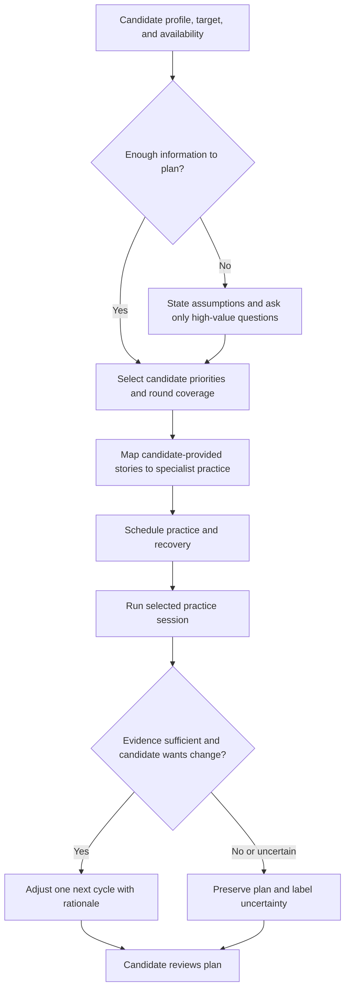

# Interview Loop Strategist

Build an adaptable preparation plan for any software-engineering interview target. The plan helps a candidate choose what to practice, maintain truthful stories across rounds, and learn from rehearsal evidence. It does not determine whether they are qualified, predict hiring outcomes, or replace the candidate's judgment.

## When to Use

Use for an end-to-end prep plan, a time-boxed reset after an interview schedule changes, mapping candidate-provided projects to round types, mock scheduling, and debrief-driven reprioritization.

Do not use for resume fabrication, employer screening, candidate comparisons, automated hiring recommendations, monitoring behavior, or a substitute for the specialist skill that teaches one round.

## Core Process

## Planning Rules

### 1. Start with candidate-owned constraints

Record the target role, organization or organization type, known interview stage, date range, available hours, preferred pace, accessibility needs, and the candidate's stated goals. Distinguish facts from assumptions. A company name is optional: use a role-family plan if the target is still exploratory.

Never convert a sparse profile into invented achievements, interview stages, or employer preferences. If a detail materially changes the plan, ask for it; otherwise make a reversible assumption and mark it for review.

### 2. Choose coverage before intensity

Cover the round types likely to matter for the target role, then weight time according to the candidate's goals and available evidence. Preserve recovery time and schedule fewer, higher-quality rehearsals when time is constrained.

| Time available | Default cadence | Plan shape |
| --- | --- | --- |
| Less than 2 weeks | 4–6 focused hours/day only if the candidate opts in | Protect essentials, one mock per high-priority round, daily short debrief. |
| 2–5 weeks | 2–3 focused hours/day | Rotate round types, build evidence map, weekly mock and review. |
| More than 6 weeks | 1–2 focused hours/day | Deliberate practice, spaced review, periodic full-loop rehearsal. |

These are starting points, not prescriptions. Reduce load when the candidate has competing commitments, fatigue, or another stated constraint.

### 3. Maintain an evidence map for stories

Map only candidate-provided projects and facts. Every story entry should identify the round, the evidence source, the audience emphasis, and open questions.

| Story facet | Appropriate rounds | Evidence to retain |
| --- | --- | --- |
| Technical decisions and tradeoffs | Coding, system design, deep dive | Architecture, constraints, alternatives, measured result or stated uncertainty. |
| Leadership and collaboration | Behavioral, hiring manager | Candidate's role, collaborators, conflict, and outcome. |
| Motivation and narrative | Recruiter, presentation, behavioral | Why the project mattered, learning, and values the candidate genuinely endorses. |

Do not invent metrics, team size, impact, safety claims, or an employer's values alignment. Flag gaps as prompts for the candidate to verify.

### 4. Use practice evidence carefully

Adjust a plan only from a candidate request or a session record that supports a specific finding. A practice score is not a trait or forecast. If a transcript is incomplete, a round differs from the target format, or there is no comparable history, say that the adjustment is tentative or leave the allocation unchanged.

The candidate can override any prioritization. Record the override as a valid preference, not a plan failure.

## Specialist Routing

| Practice need | Route to | Strategist responsibility |
| --- | --- | --- |
| Coding or online assessment | `senior-coding-interview` | Set cadence and connect debrief evidence to the next cycle. |
| System design | `ml-system-design-interview` or a general design specialist | Choose target-relevant constraints; do not assume an ML role. |
| Technical deep dive | Relevant domain specialist | Preserve factual project evidence and open questions. |
| Presentation | `tech-presentation-interview` | Reserve rehearsal and recovery time. |
| Behavioral or values | `values-behavioral-interview` | Maintain candidate-authored story coherence. |
| Hiring-manager conversation | `hiring-manager-deep-dive` | Frame scope, collaboration, and candidate questions. |
| Timed rehearsal | `interview-simulator` | Use candidate-controlled artifacts and evidence-linked debriefs. |

## Adjustment Decisions

| Signal | Action |
| --- | --- |
| Candidate asks to prioritize a round | Reallocate time, showing what is deprioritized. |
| Evidence-linked mock debrief identifies one repeatable gap | Add one targeted practice experiment in the next cycle. |
| One weak or incomplete session | Label it as limited evidence; do not overhaul the plan. |
| Interview date, format, or availability changes | Rebuild the remaining schedule from current constraints and retain completed evidence. |
| Candidate has no project stories ready | Schedule evidence gathering and short story drafts before advanced rehearsal. |
| Target details are unknown | Use a general SWE coverage plan and list the assumption for review. |

## Quality Gates

- [ ] Candidate priorities, constraints, and consent choices are visible in the plan.
- [ ] Known facts, assumptions, and unknowns are distinct.
- [ ] Every story claim originates in candidate-provided evidence or is marked as a question.
- [ ] Every plan adjustment names a candidate request or session artifact.
- [ ] No item claims to measure confidence, culture fit, integrity, personality, or hiring likelihood.
- [ ] The candidate can revise scope, cadence, and routing at each review point.

## Anti-Patterns

### Company Template Masquerading as a Plan

**Novice**: "Every senior candidate needs the same company-specific loop and values mapping."

**Expert**: Target role, organization, stage, and timeline may differ or be unknown. Start from role-family coverage, then add verified target information the candidate chooses to use.

**Detection**: A plan assumes one employer, one interview sequence, or one values framework without candidate input.

### Coherence by Invention

**Novice**: "Fill missing metrics and leadership details so stories sound consistent."

**Expert**: Coherence comes from a truthful evidence map. Missing information is a prompt to verify, not a license to manufacture a stronger narrative.

**Detection**: Unattributed outcomes, team sizes, dates, or metrics in a story matrix.

### Score-Driven Overcorrection

**Novice**: "One low mock score means that round should dominate the remaining plan."

**Expert**: Practice evidence is bounded by prompt, format, quality, and the candidate's own assessment. Change one cycle at a time and make the rationale visible.

**Detection**: Large allocation changes without a candidate request, repeated evidence, or confidence label.

### Surveillance as Readiness

**Novice**: "Attention, gaze, tone, or emotion metrics show whether someone is prepared."

**Expert**: Those signals are ambiguous and inappropriate for this use. Readiness work should be based on candidate-chosen practice artifacts and explicit self-reflection.

**Detection**: Any readiness recommendation based on camera, biometric, behavioral, or inferred affect data.

## Worked Example

**Setup:** A mid-level platform engineer targets a staff-leaning backend role in five weeks. They can commit eight hours each week, have two projects they are comfortable discussing, and do not yet know the loop format.

**Plan:** The strategist records the unknown format, allocates one coding and one design practice block per week, schedules a behavioral story-evidence session before the first mock, and leaves an explicit review point after the recruiter screen.

**Adjustment:** A design mock transcript shows that the candidate jumped into components before naming constraints. The next cycle adds one 20-minute constraint-framing drill. It does not infer confidence or recalculate the entire plan from one session.
