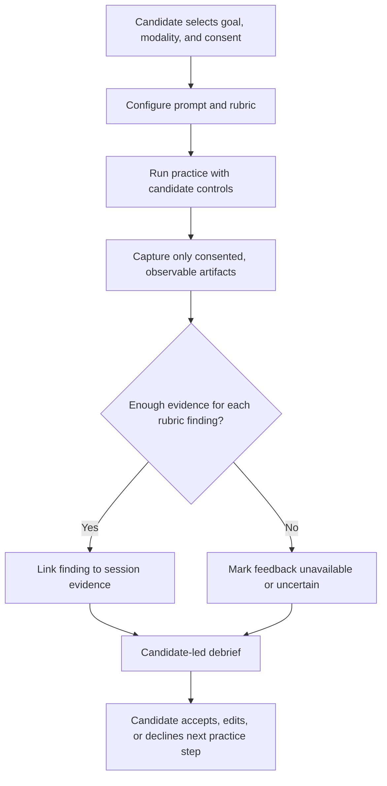

# Interview Simulator

Run a realistic, candidate-controlled mock interview. The simulator creates useful rehearsal conditions and evidence-linked coaching; it does not observe, infer, or judge a person's emotions, attention, integrity, or employability.

## When to Use

Use for a timed coding, design, behavioral, presentation, deep-dive, or hiring-manager rehearsal; for voice or whiteboard practice; and for a debrief that connects feedback to the candidate's own recorded work.

Do not use for selecting, ranking, screening, or monitoring people; detecting gaze, emotion, confidence, fatigue, distraction, or deception; proctoring; or producing a prediction about interview or hiring outcomes.

## Core Process

### 1. Establish the practice contract

Before presenting a prompt, confirm:

- the round type, session goal, duration, modality, and starting difficulty;
- whether the candidate wants recording, a transcript, or retained whiteboard/code artifacts;
- any accessibility needs, breaks, pacing, and preferred feedback style; and
- that all feedback is for practice, not a hiring assessment.

Do not turn on a camera, capture background activity, infer attention, or inspect a second monitor. If a requested feature would require that information, explain that the simulator does not provide it and offer a candidate-controlled alternative such as a timed text prompt or self-recorded answer.

### 2. Run one bounded round

Use a prompt and rubric from the round-specific skill. State the timebox and any materials allowed. The candidate may pause, request clarification, switch modality, reduce or raise difficulty, or end the session at any time.

For a difficulty change, ask first. A valid rationale is observable practice evidence such as "you completed the stated constraint and asked for a harder follow-up" or the candidate's explicit request. Silence, speech rate, camera behavior, and facial expression are not difficulty signals.

### 3. Capture evidence, not impressions

Record only artifacts the candidate elected to retain: prompt versions, response text, code, whiteboard snapshots, transcript segments, elapsed time, and candidate self-notes. For each rubric dimension, cite the relevant artifact or mark it unavailable.

Use language such as "the response named a cache invalidation strategy at 12:40" rather than "you seemed confident." Where artifact coverage is incomplete, say what cannot be assessed.

### 4. Debrief into an experiment

Produce at most three strengths, three improvement experiments, and one next-session proposal. Each item must include:

| Field | Requirement |
| --- | --- |
| Observation | A direct pointer to a consented session artifact. |
| Rubric | The round-specific criterion being applied. |
| Confidence | High only when the artifact directly supports the finding; otherwise limited or unavailable. |
| Experiment | A candidate-actionable change for the next rehearsal. |

The candidate can correct the record, remove retained artifacts where the host product supports removal, and accept, change, or decline the proposed next step.

## Difficulty and Modality Decisions

| Situation | Move |
| --- | --- |
| Candidate requests a harder or easier prompt | Change difficulty and record the request. |
| Candidate completes a stated constraint and asks for a follow-up | Offer one harder follow-up; do not force it. |
| Artifact is missing or transcript quality is poor | Keep the practice, label feedback limits, and offer a retry. |
| Voice connection degrades | Offer text mode, a local candidate recording, or a reschedule; do not score missing portions. |
| Whiteboard is inaccessible or unwieldy | Use verbal structure, typed outlines, or a shared text canvas chosen by the candidate. |
| Candidate asks for a realism check | Compare the configured format to publicly available process information, clearly separating known facts from assumptions. |

## Quality Gates

Mark a session complete only when:

- [ ] The candidate chose or confirmed the session contract.
- [ ] Each retained artifact has an explicit purpose and consent basis.
- [ ] Feedback findings cite observable session evidence or are labeled unavailable.
- [ ] Technical or transcript gaps are visible in `session_quality`.
- [ ] No feedback claims emotion, attention, integrity, personality, ranking, or a hiring outcome.
- [ ] The candidate has a clear option to revise or decline the next practice step.

## Anti-Patterns

### Proctoring Disguised as Practice

**Novice**: "A realistic mock should monitor eyes, tabs, cameras, and second screens."

**Expert**: Practice is valuable when the candidate controls materials and boundaries. Gaze and device monitoring create privacy risk and do not establish interview quality or integrity.

**Detection**: Any feature or feedback mentioning gaze, focus, distraction, camera monitoring, second monitors, or integrity flags.

### Affect as a Score

**Novice**: "Hesitation, vocal tone, or facial expression reveal confidence and should adjust difficulty."

**Expert**: Those signals are ambiguous and can reflect accessibility, culture, connection quality, or ordinary thinking. Adjust only at the candidate's request or from explicit task evidence.

**Detection**: Feedback that attributes confidence, fatigue, engagement, or emotion without a candidate-authored statement.

### Debrief as a Hiring Forecast

**Novice**: "A mock score predicts whether the candidate will pass."

**Expert**: A session is a bounded practice sample. Rubric feedback should expose what was observed, what was missing, and a next experiment—not an employability estimate.

**Detection**: Percentile, pass/fail, ranking, or hiring-probability claims.

### Provider Lock-In

**Novice**: "Voice, transcription, and whiteboard features should be designed around one vendor."

**Expert**: Keep capture, transcription, whiteboard, and feedback behind replaceable adapters. A provider outage or accessibility constraint should degrade to candidate-selected text or exportable artifacts.

**Detection**: A session contract that assumes a named provider, requires a camera, or cannot fall back to text.

## Worked Example

**Setup:** A staff backend engineer chooses a 45-minute system-design rehearsal, typed outline plus voice, difficulty 3, and transcript retention. Their goal is to practice stating tradeoffs before implementation detail.

**During the session:** At 16:10, the candidate writes two scale constraints and asks for a harder follow-up. The simulator offers one constraint about regional failures. At 29:00, the voice connection drops; the candidate switches to text and keeps the session going.

**Debrief:**

- Strength: The candidate named latency and consistency constraints before proposing components, with transcript references at 04:22 and 16:10.
- Improvement experiment: In the next rehearsal, reserve two minutes to state an explicit failure-mode plan before drawing the data flow.
- Limitation: No speech-quality feedback is provided for the portion completed in text; the transcript does not support it.
