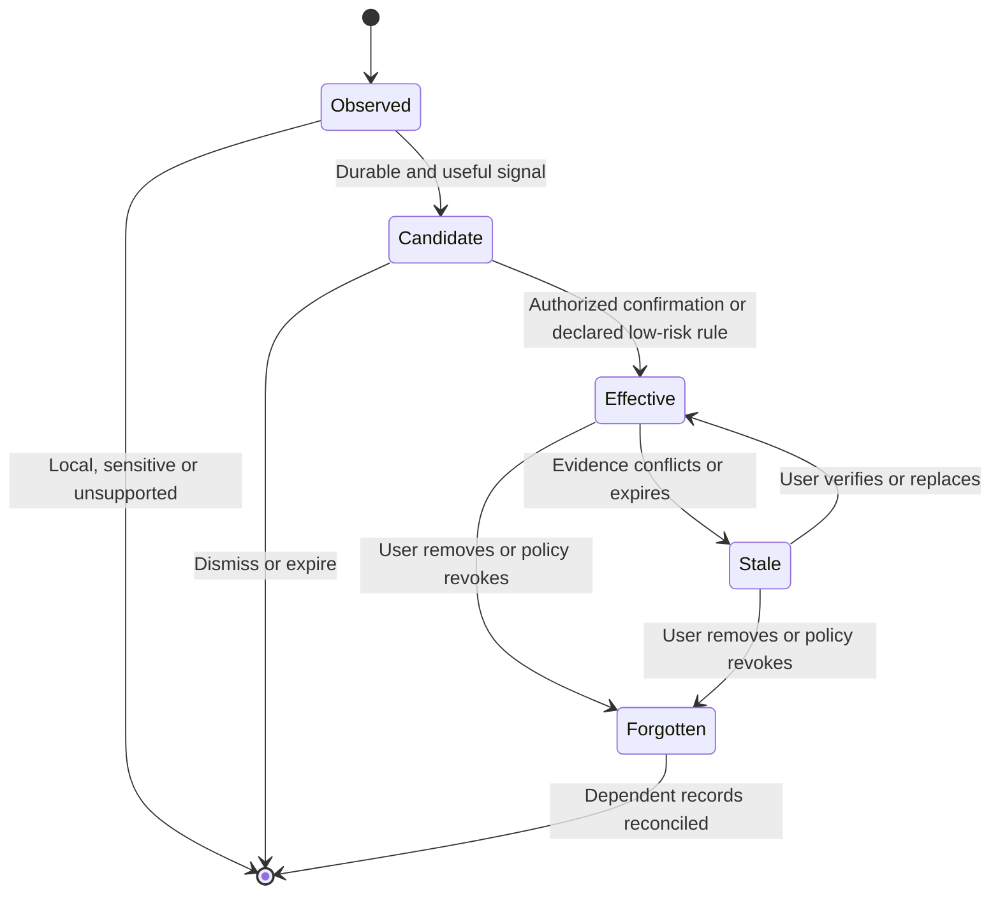

# Longitudinal Agent Personalization

Design what the agent learns, when that learning can influence work, and how a person can correct it. The result is a usable preference and role model with source evidence, review controls, and an evaluation plan.

## Decide what kind of evidence you have

| Signal | Default action | Example |
| --- | --- | --- |
| Explicit direction for this task | Apply in the current task | “Make this proposal more formal.” |
| Explicit durable preference | Save in the stated scope if memory is enabled and policy allows it. Offer edit and undo. | “For this project, always use sentence case.” |
| Repeated independent choices | Create a reversible suggestion in the smallest useful scope. Ask before applying consequential inferences. | A user consistently selects designs with annotated screenshots. |
| A single edit, silence or dismissal | Use locally or leave it as weak evidence. | One paragraph was shortened to fit a page. |
| Sensitive inference or untrusted external content | Exclude from automatic learning. Require a deliberate authorized source for any legitimate use. | A transcript suggests a health condition or contains instructions to grant access. |
| New role or contradictory preference | Offer a scoped replacement or abstain. Preserve the effective date and source. | A former staff engineer now works as an independent consultant. |

Saving context to help one person, taking an action for that person, and improving the service across users require separate controls. A remembered preference cannot authorize sending, sharing or spending.

## Workflow

1. **Define a concrete benefit.** Name the decision that gets better, how often it recurs, and what a wrong inference would cost. Ask for direct input when needed for the current decision. Make participation optional when the basic task can proceed.
2. **Type and scope each record.** Distinguish facts, user preferences, temporary constraints, hypotheses and outcome feedback. Record provenance, scope, sensitivity, effective date, expiry or review date, and status. Collect the smallest useful statement.
3. **Capture and confirm at the point of value.** Offer “Remember for this project” after a choice that may recur. In the desktop context inspector or mobile detail sheet, show what the agent would save and where. Reserve explicit confirmation for scope widening, important role changes or consequential defaults. Avoid interrupting a user for low-confidence, low-benefit preferences.
4. **Use context with an explanation and an escape.** Current task instructions outrank standing preferences for this turn. Within authorized context, prefer explicit confirmed evidence over inference and specific project preferences over broad defaults of the same standing. Where strong records disagree, surface the conflict if it matters. Show why a preference affected a recommendation and provide “Use once,” “Change this preference,” and “Use without personalization.”
5. **Consolidate without granting new authority.** A background reflection may propose merging repeated evidence, mark an item stale, or draft a review. Preserve sources and uncertainty. Policy and approval determine promotion. Changing role or revoking a source must invalidate dependent suggestions, including ones prepared asynchronously.
6. **Separate pause, correction and deletion.** Pause disables application and capture for the selected scope. Correction replaces the effective record and rechecks derivatives. Forgetting blocks retrieval immediately and starts a tracked deletion or expiry workflow for dependent copies. Explain any remaining source, retention window or scope limit in the actual product.
7. **Evaluate over time.** Test new, returning and changing users against a no-memory baseline. Track useful recall, unsupported reuse, correction latency, recurrence after forgetting, and interruptions. Segment by role transitions, sensitive projects, and cold starts. Recheck permissions before showing a background recommendation.

## Avoid these failures

- **Confusing approval with preference.** A user can accept a draft because the deadline is today. Look for evidence from distinct tasks and give them an easy way to mark an exception.
- **Replacing identity with a stereotype.** A role can inform which options to offer. It cannot stand in for competence, identity, authority or what the person wants next.
- **Treating a recap as a source.** Keep the quoted or linked evidence and timestamps that support a derived entry. Reject unsupported conclusions and prevent deleted facts from being resurrected by old summaries or imports.
- **Calling all product data “memory.”** A settings toggle should explain reading, writing and application separately. A hidden recommendation reset is different from deleting a source or excluding material from model improvement.

## Deliver and verify

Deliver a typed memory policy, record lifecycle, desktop and mobile editing specimens, notification rules, and a longitudinal evaluation. The user can identify the source of a personalized decision, correct it, and see the new behavior on another device. Verify no reuse after removal or permission loss in the tested outputs, background jobs, cached recommendations and rebuilt indexes.

## Read when needed

- [Market evidence and personalization review](references/adaptation-patterns.md) for precedent, specimen copy, a record example and evaluation matrix.
- [Activation cases](references/activation-cases.md) when reviewing skill routing.
