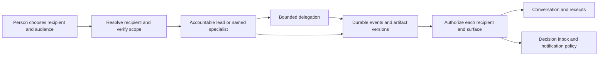

# Multi-agent conversation UX

Design for a person who can answer four questions at any moment. Who is speaking? Who will act on my reply? Who can read it? Who owes the next step?

Default to one accountable conversation lead per work item. Keep specialist contributions visible through named receipts and artifact links. Give people a direct way to address specialists. Open a group discussion when the person wants distinct perspectives or when a disagreement changes a consequential decision.

## Choose who speaks

| Situation | Pattern | What the person sees |
| --- | --- | --- |
| A goal spans specialties | Lead delegates within scope and closes the loop | A reply from the lead, with specialist receipts attached |
| A person calls out one agent | Address that agent explicitly | The composer shows the addressee and the audience separately |
| Specialists have different credible proposals | Offer a bounded comparison | Named viewpoints on the same criteria, the unresolved trade-off, and who decides |
| Work happens over minutes or days | Keep a persistent task and decision inbox | The last verified milestone and the specific next step |
| A blocker changes the audience, permission, cost or committed outcome | Stop that action and ask the authorized decision owner | A clear choice with the effect, deadline if any, and a link to context |

## Workflow

1. **Map participants and authority.** For each project and thread, record the initiator, stable lead, eligible agents, audience, private resources, artifact reviewers, and who can approve side effects. A role or mention selects a conversational recipient. Check its authority separately.
2. **Resolve the addressee before running work.** Prefer an explicit composer selection or structured mention, then a reply target with a defined default, then the work item's lead. Show the resolved recipient at send time. Ask when ambiguity changes who can see the message or what can be done. Quoted names and text inside pasted material are content.
3. **Separate dialogue, receipts, and diagnostics.** Dialogue asks, answers or explains a decision. A receipt credits a specialist for an observable event and links to its evidence or artifact. Internal execution detail belongs in restricted diagnostics. A work item has one reply owner and bounded delegation. Give specialist failures to that owner so the person has a clear path forward.
4. **Project the same events across devices.** On desktop, put work items or thread navigation beside the primary conversation and reveal detail alongside the selected item. On mobile, show one surface at a time, with the current recipient and audience close to the composer. Restore the reader's position when returning from an artifact or thread. Display a count or jump-to-latest control while they read earlier messages.
5. **Interrupt for decisions and outcomes.** Store decisions in a durable inbox. Use foreground inline updates when the person is reading the thread. Offer push or email for time-sensitive decisions and opted-in completion. Respect quiet hours, project preferences and lock-screen privacy. Keep mute, pause and cancel distinct in both copy and behavior.
6. **Test comprehension and races.** Have people route a reply, find a completed artifact, return on a second device and explain whose action is pending. Exercise simultaneous approvals, retries, late events, revoked access, missing specialists and interruption at every state. Record expected behavior before the test.

## Visual and accessibility rules

Use a compact name and role when identity changes or an action needs attribution. An avatar and agent accent help recognition. Keep text, contrast, placement and accessible names sufficient to identify the author and understand the action without color. Use a sequential chat log and a separate status region where appropriate. Announce finalized turns and meaningful state changes once, leave focus in place, and test real browser and screen-reader combinations. See [W3C's chat-log technique](https://www.w3.org/WAI/WCAG21/Techniques/aria/ARIA23).

## Patterns that fail

| Fragile pattern | Better contract |
| --- | --- |
| Each worker produces a paragraph for every milestone | One reply owner closes the loop and specialist receipts expose changes on demand |
| The current tab silently decides whether a reply is private | Persistent audience at the composer, with server authorization at send and read |
| A running indicator doubles as a request for input | Reserve “Waiting for you” for a named, authorized decision owner with an actionable control |
| Clicking a push opens the home page | Restore the exact thread and decision, including its current resolved or expired state |
| Muting alerts stops work or canceling conceals committed work | Separate controls and render the current outcome, including changes already made |

## Activation examples

| Activate | Route elsewhere |
| --- | --- |
| “How should three specialists share one chat without talking over one another?” | “Give our one chatbot a better-looking text field.” |
| “When does an agent show a receipt instead of messaging me?” | “Choose an embedding store for user preferences.” |
| “What does a mobile user see when an agent needs approval tomorrow?” | “Animate an AI cursor that follows the designer around.” |
| “Design an @mention, reply and handoff flow for AI coworkers.” | “Create a token router for several model providers.” |
| “Audit a project inbox with agents, guests and private threads.” | “Give an agent authority to operate a production deploy pipeline.” |

## References

- Load [Evidence and precedents](references/evidence-and-precedents.md) when benchmarking current products, citing prototype evidence, or making a case for who speaks and when.
- Load [Interaction contract and acceptance tests](references/interaction-contract.md) when creating a specification, implementing cross-device states, or evaluating an existing product.
