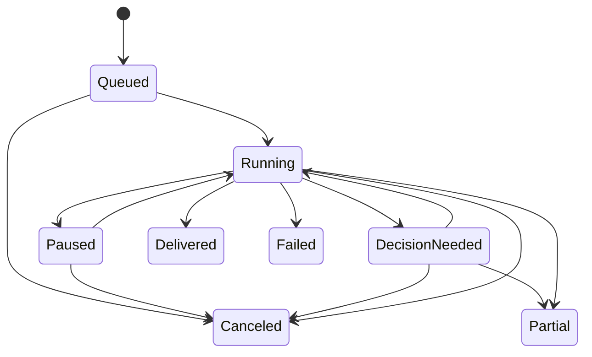

# Interaction contract and acceptance tests

This is a starting contract for a project where a lead and several specialists collaborate with one or more people.

## Event envelope

| Field | Meaning |
| --- | --- |
| `event_id`, `thread_id`, `work_item_id`, `sequence` | Stable identity and authoritative order within a thread. Retrieve missing events before announcing a late stage as complete. |
| `actor_id`, `actor_kind`, `initiated_by` | Actual author or service, plus the human or job whose authorized intent initiated the chain. |
| `addressee_ids`, `audience_policy_ref`, `reply_to` | Who should act, who can see the event, and the event being answered. Resolve visibility with current policy at delivery and read time. |
| `kind`, `caused_by`, `run_id`, `attempt_id` | Distinguish dialogue, handoff, progress, artifact, decision request, decision, failure and terminal outcome. Retain causal provenance across retries. |
| `resource_refs`, `expected_revision`, `idempotency_key` | Identify scoped sources or artifacts, enforce the revision expected by the writer, and avoid repeating a committed effect. |
| `decision_owner_id`, `decision_id`, `expires_at` | Required for a decision request. Record options and consequences. Validate that the owner is authorized for the chosen option at commit time. |

A handoff carries the bounded task, allowed resources and actions, deliverable, deadline and reply owner. Agents get only what their scoped task and the initiator's authority allow. Send recipient-authorized projections of events to clients. Apply that policy to output, source titles, file previews, summaries, notification routing and live subscriptions as well as direct links. Recheck at action time. Treat quoted text, web content and agent-generated prose as inputs. Only trusted orchestration events may dispatch another run. Apply a deadline, fan-out cap and cycle guard to dispatches.

Store receipts durably when they identify a verified artifact, completed milestone or meaningful handoff. Acknowledgements internal to the runtime can remain in restricted diagnostics. If a timeout leaves the result uncertain, reconcile against the target before retrying. Record confirmed changes separately from intended changes and say which portions succeeded. Use an outbox or equivalent so a committed decision is still delivered after a worker or client restart.

## Timing and controls

Give the person control over participation without requiring them to route every turn. In **lead coordinates**, named specialists can work and the lead synthesizes. In **only when addressed**, agent dialogue requires a direct request, while existing work can still produce receipts. In **compare perspectives**, show the number of requested agents, a response window and one turn per specialist before a synthesis. If the person interrupts, acknowledge the steering, identify any committed effects, and carry the new intent into the next work item revision. Label mode changes in the thread.

| Event | Foreground treatment | Away treatment |
| --- | --- | --- |
| Working or typing | Quiet transient signal, with a last verified milestone for long work | Keep available in the work-item view |
| Durable progress or specialist handoff | Compact receipt or collapsed batch | Update activity. Digest when followed and configured |
| Needs a decision | Clear choices anchored to the work item and labeled by consequence | Durable inbox item. Notify the authorized decision owner when urgency and settings allow |
| Review ready or finished | Link to result, scope and any remaining work | Opted-in completion alert or digest |
| Failure or partial work | Explain the verified effect and recovery, or close as canceled | Alert only when the configured policy or an actionable consequence warrants it |

Deduplicate sends by recipient and semantic event or decision. Foreground can update the visible thread quietly while background channels consult the same read and preference state. Use minimal notification payloads with a scoped deep link and fetch authorized content after opening. Drop queued alerts when a newer outcome supersedes them. For an already delivered alert, the destination resolves to the current state. Keep the draft on reconnect and retry sends without producing a second user turn.

Treat a decision as a separate durable entity. Pausing suspends future work at a checkpoint. Muting changes delivery preferences. Canceling stops further execution and reports any effect already committed. Treat a late result as stale when its work item is canceled or superseded. Have the accountable lead close the loop with an honest result.

## Worked example

Mira asks Edie in her private portfolio project, “Can we show the impact of the search rebuild?” Edie owns the reply. She hands Vera two evidence references cleared for the task and hands Iris a request for a layout using the existing approved copy. Mira sees that work has started in one quiet line.

Vera marks one number as awaiting clearance. Iris returns a reviewable layout and the thread shows a compact receipt, “Iris added a preview.” Edie asks Mira to approve the sourced public claim or proceed with a qualitative version. The layout remains reviewable while publishing waits. An external reviewer who can see the preview receives only its authorized version, without the private evidence or details of the pending decision.

Mira returns on her phone and opens the decision from her inbox. The approval rechecks her authority and the preview's revision. If she already chose on her laptop, the phone shows that choice and its outcome. When the work closes, Edie says what was published and links to the published version. If an evidence check never completes, the lead offers the qualitative option and states which claim remains unverified.

## Acceptance tests

| Exercise | Pass condition |
| --- | --- |
| Reply to a message that quotes another agent, then explicitly mention that agent | The composer and routing agree. Only the structured recipient changes the destination. |
| Send a team request with a restricted attachment and add an external reviewer | Restricted bytes, names and derived excerpts stay outside the reviewer's event stream, search, previews and alerts. |
| Change project during a draft and resume the earlier conversation on a second device | An unsent draft is scoped to its thread. The selected audience and recipient remain legible on both devices. |
| Open a notification after the decision expired, after access was revoked, and after approval on another device | Each link resolves to a truthful current state with no unauthorized content and no duplicate action. |
| Deliver completion twice and send an older status after cancellation | The client shows one result, preserves the terminal state and exposes any verified committed effect. |
| Delay one specialist beyond the deadline and attempt a circular handoff | The lead gets one actionable failure or partial result. The runtime stops recursive dispatch. |
| Read old messages while new ones stream at narrow width, 200% zoom and with a screen reader | New activity preserves scroll and focus. Final turns and meaningful status are announced once. The reader can reach new content intentionally. |
| Disable push and return the next day | Outstanding decisions and available results are still findable by project and work item. |
| Compare two specialists with conflicting recommendations | Both positions keep author, rationale and criteria. The person can identify the accountable decision owner. |

Track wrong-recipient rate, redundant visible turns, time to identify the next action, re-entry success, duplicate alerts and permission failures. Include screen-reader and touch tasks. An early study can compare a lead-first flow and a visibly multi-agent flow using the same underlying work. Treat notification engagement as context for judging whether someone got the right information in time.
