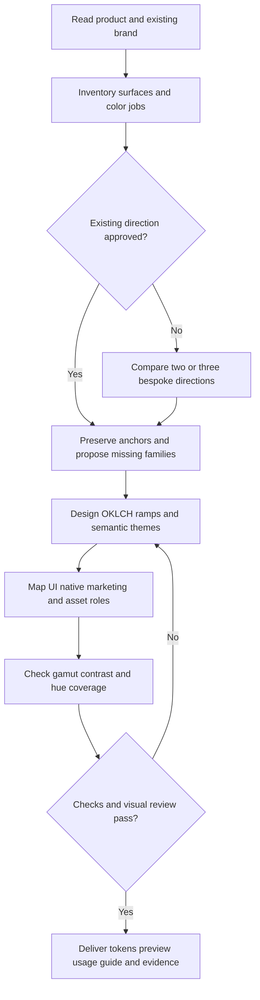

# Product Palette Designer

Build a color system that belongs to the product and works from a tiny favicon
to a dense app screen and an expressive campaign. Author in **OKLCH**; derive
RGB/hex only for consumers that need them. Treat harmony as a visual design
judgment informed by theory, with accessibility measured independently.

Guidance checked **2026-10-25**. Framework snippets target Tailwind **v4** and
CSS-variable shadcn/ui; inspect the actual project before adapting other versions.

## When to use

Use for a new product palette, rounding out an existing brand, color roles and
shades, a Tailwind/shadcn theme, adaptive native colors, or coordinated brand assets.
Treat Tailwind, shadcn/ui and native platforms as implementation targets. Choose
the product mood from its brief, and retain platform conventions in the exports.

For image collections and photo ordering, use the separate computational color
harmony skill. For a full accessibility review, use a dedicated accessibility
workflow; this skill's pair checks cover only declared colors and contexts.

## Process



### 1. Establish the product, then the palette

Read available product/UI files, logo, screenshots, positioning, audience,
competitors, and existing tokens. Identify the product's task, purchase context,
desired character, content density, cultural context, platforms, accessibility
needs, and fixed brand colors. Research and cite any external brand claims.
Ask only for missing facts that materially change the direction; otherwise state
reasonable assumptions and continue with a concrete proposal.

Build a **surface inventory**: app shell, navigation, reading, forms, primary and
secondary actions, links, focus, selection, error/success/warning/info, charts,
marketing sections, illustration, logo, favicon, app icon, OG/social, and email.
Add print, maps, syntax, or domain-specific categories when the product needs them.
Do not invent unused UI components merely to fill a token table.

### 2. Choose a reasoned harmony and occupy the wheel deliberately

Read [references/color-theory.md](references/color-theory.md) for Itten, Albers,
Chevreul, Munsell, perceptual spaces, and harmony recipes. Translate theory into
specific decisions: dominant/supporting hue relationships, lightness structure,
chroma hierarchy, area proportions, and colors that must remain distinguishable.

Compare two or three short directions when the brief is open: name the character,
anchors, tradeoffs, and likely application. Recommend one and complete a candidate
palette so the user has something concrete to assess. Obtain visual-direction
approval before applying a broad redesign to an existing product.

Create an **extended full-wheel palette**: use complementary, split-complementary,
triadic, tetradic, or related families as a starting structure; assign gaps to
meaningful status, chart, editorial, or illustration roles. Show a labeled hue map
and the largest cyclic gap. Six 60-degree families are one possible scaffold,
not a mandate or proof of harmony. Explain any deliberate gap or near-duplicate.

Keep a clear core identity within that wider repertoire. Choose density and color
area per surface: a reading screen and a campaign illustration need different
balances. Never force every family into every viewport, and never reduce a vivid
brief to a neutral dashboard by default. Status colors must keep their meanings
when brand or campaign colors overlap them; add labels, shapes, or icons.

### 3. Build bespoke shade ramps

For each family, define its name, anchor, hue, chroma envelope, temperature,
intended jobs, prohibited uses, and 50–950 shades. Use independent L/C/h control;
reduce chroma near light/dark extremes and adjust hue by eye when useful.
Specify all values as `oklch(L C h)` with L in 0–1. Hue is powerless at C=0.

Do not paste a stock Tailwind palette and rename it. Preserve supplied anchor
colors as explicit immutable values; if accessibility requires another shade,
create a functional variant and explain the difference. A ramp's 500 shade is
not automatically the brand anchor, a button fill, or safe with white text.

Prefer an sRGB-safe essential UI baseline plus optional clearly labeled Display
P3 artwork. Check actual gamut, use a declared mapping method, and inspect exports.
Fixed-L/h chroma reduction is the bundled tool's conservative policy; it is not
an implementation of the CSS specification's browser gamut-mapping algorithm.

### 4. Map primitives to semantics to components and assets

Read [references/platforms-and-assets.md](references/platforms-and-assets.md) for
current integration details. Return a use table, not just attractive swatches.
Separate primitive family shades, semantic roles, and component/state aliases.
Components consume roles; marketing can also use intentional palette primitives.

Define complete light and dark mappings: all shadcn surface/foreground pairs,
primary/secondary/muted/accent/destructive, border/input/ring, chart-1 through
chart-5, and sidebar roles. Add success/warning/info with foregrounds, links,
selection, and explicit hover/active/focus roles. These added roles are **product
extensions**, not promises about built-in shadcn components. Assign disabled,
visited, selected, loading, and inverse roles where the inventory needs them.

Choose dark mappings deliberately rather than numerically inverting light mode.
Check elevation, muted copy, input boundaries, brand fills, shadows and overlays.
Document contrast/appearance variants and native platform dynamic-color policy.
Export concrete color-managed RGB values for native assets; keep OKLCH as source.

Provide logo full-color/one-color/reversed usage, favicon/app-icon small-size
behavior, OG/social backgrounds and text pairings, campaign accents/gradients,
and email/print fallbacks as applicable. Flat logo anchors stay stable while
artwork gets a broader palette. A colored placeholder is not a finished logo.

### 5. Generate, measure, and inspect

Use [examples/fieldnotes.palette.json](examples/fieldnotes.palette.json) as the
**input contract**, not a palette to copy. It is a fictional example with six
chromatic families, one neutral family, two complete themes, and explicit pairs.
Read [references/toolkit.md](references/toolkit.md) before using the bundled tool.
From the skill directory:

```bash
python3 scripts/palette.py examples/fieldnotes.palette.json --check
python3 scripts/palette.py examples/fieldnotes.palette.json --out /absolute/owned/palette-output
python3 -B -m unittest discover -s scripts -p 'test_palette.py'
```

For repository work, choose the output directory inside the task's verified
linked worktree. The output includes `palette.json`, `tokens.css`, and an offline
`preview.html`. The tool has no model calls or network access. Its measured
lightness/chroma recipes are starting points; revise the spec and re-run after
visual review. Use semantic literals for exact anchors and custom shade values.

Check **rendered** UI at desktop/mobile and 200% zoom; light/dark and increased
contrast; actual typography, focus/hover/pressed/disabled/selected/error states;
charts with labels; grayscale and protan/deutan/tritan simulations; image/export
decode; favicon at 16/32 px; logo reversal; OG at thumbnail size. For gradients,
translucency, shadows, imagery, and P3, inspect the actual composite and final
export. The numeric checker only handles opaque sRGB pairs.

Use WCAG 2.2 AA text thresholds 4.5:1 normal and 3:1 large, and applicable 3:1
non-text contrast. Evaluate focus visibility/obscuration separately. Do not round
up failing ratios. OKLCH lightness is not relative luminance; ΔE and hue distance
are not contrast. APCA and simulations supplement evaluation, not AA certification.

## Deliverables and completion

Use [templates/palette-handoff.md](templates/palette-handoff.md). Deliver:

1. Product brief, assumptions, selected direction, and rationale tied to evidence.
2. Labeled wheel/coverage map, bespoke ramps in OKLCH, family roles and restrictions.
3. Complete light/dark semantic map and component/state/asset use tables.
4. Targeted Tailwind/shadcn/native exports with source/derived color-space metadata.
5. Visual review board: real UI, marketing, logo usage, favicon, OG and chart samples.
6. Pairwise numeric results, inspected artifacts, remaining gaps, and refresh date.

Distinguish a proposed palette, checked opaque pairs, inspected browser output,
and native/asset export proof. Never claim a product is accessible, shipped, or
brand-approved solely because the generator exits successfully. The bundled
fictional preview illustrates color use; it does not constitute product approval.

## Anti-patterns

### A beautiful wheel is a usable theme

**Novice:** Choose equidistant hues and use them equally everywhere.
**Expert:** Balance L/C/h, adjacency and area in real layouts; assign every family
jobs and preserve task hierarchy. Angular symmetry is only a proposal.

### The contrast looks right in OKLCH

**Novice:** Approve a pair by ΔL, ΔE, or the shade number.
**Expert:** Convert the final in-gamut color to linear sRGB luminance, compute the
actual pair, then inspect its composited rendered context.

### One brand fill works for every state and platform

**Novice:** Put the brand hex into primary, links, focus, native assets and OG text.
**Expert:** Keep the anchor, design functional variants and paired foregrounds,
and export through each target's color and appearance model.

### A 60/30/10 ratio is a scientific rule

**Novice:** Force all products into a fixed distribution or universal color emotion.
**Expert:** Treat ratios and associations as hypotheses; validate the product,
audience, culture and surface. Avoid invented empirical guarantees.

## Bundle guide

- [references/color-theory.md](references/color-theory.md) — Read when selecting
  harmony, balancing the wheel, or explaining perceptual/color-theory decisions.
- [references/platforms-and-assets.md](references/platforms-and-assets.md) — Read
  for framework versions, native exports, accessibility requirements and asset QA.
- [references/toolkit.md](references/toolkit.md) — Read before generating/checking
  a spec; includes input fields, mapping policy and validation limits.
- [templates/palette-handoff.md](templates/palette-handoff.md) — Use for a finished
  palette proposal and implementation handoff.
- [examples/fieldnotes.palette.json](examples/fieldnotes.palette.json) — Run the
  fictional example to inspect the contract and obtain a testable preview.
- [examples/activation-evals.md](examples/activation-evals.md) — Use to evaluate
  discovery boundaries after changing the description.
- [scripts/palette.py](scripts/palette.py) — Run for deterministic ramps, audits,
  Tailwind token exports, derived sRGB values, and a self-contained HTML preview.
- [scripts/test_palette.py](scripts/test_palette.py) — Run for conversion, gamut,
  contrast, malformed-input and export regressions.
- [agents/openai.yaml](agents/openai.yaml) — Runtime display metadata for Codex.
- [README.md](README.md) and [CHANGELOG.md](CHANGELOG.md) — Bundle use and history.
