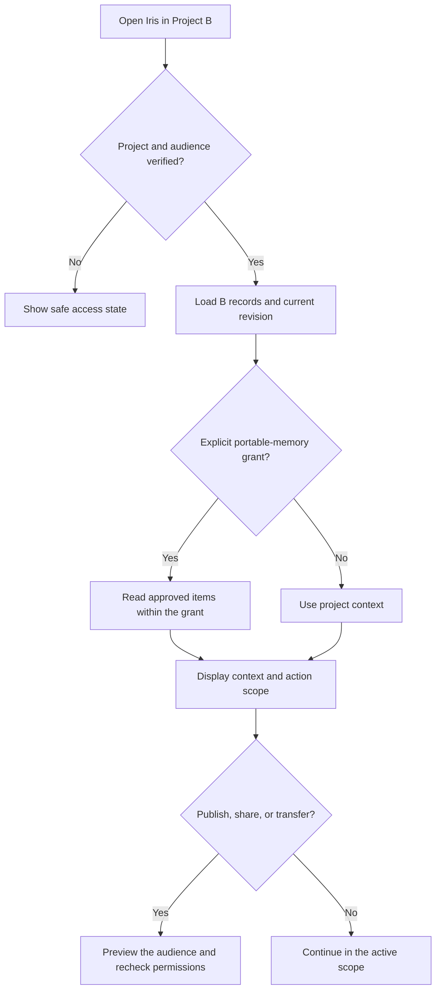

# Project-Scoped Agent Relationships

Design continuity across years and projects with a stable specialist identity, a visible working scope, and permissioned memory. A user can recognize Iris in two projects even when Iris is authorized to read only one project at a time.

## Define five independent scopes

| Scope | Question | Example |
| --- | --- | --- |
| Specialist identity | Whose work and role is this? | Iris, art director |
| Active project | Which workspace and artifact revision are in view? | Portfolio / v7 |
| Conversation audience | Who can read the turn and its attachments? | You and Iris |
| Memory read and write | Which records can inform the turn, and where can new records land? | Portfolio reads and writes; approved personal preferences read-only |
| Action authority | What can be changed or shared in this run? | Create a private draft and request review |

Treat tenant, project, record audience, and action scope as policy dimensions. The visible name and persona color communicate identity. They confer no data access. The same agent can have multiple runtime instances. Never describe a continuously running presence unless the system can verify it.

## Workflow

1. **Inventory relationships and boundaries.** List the people, specialist roles, project memberships, private conversations, shared artifacts and background work. Name who may inspect each record, including on a shared device or after membership changes. State whether projects can read account memory, write account memory or import selected items. Those are separate grants.
2. **Give the user a stable orientation.** Keep specialist name, project, and audience visible near the composer or action. On desktop use a persistent context strip and an inspectable context panel. On mobile use the same short labels at the point of action, with a sheet for details. Distinguish agent-private interview notes from a personal preference that several authorized specialists may use.
3. **Design transitions before the happy path.** Test a new project, switch with an unsent draft, sharing, copying, archiving, access revocation, return after a month, and switching devices while work runs. Preserve drafts by project and audience. Rebind the composer and artifact before accepting the next send. The old run stays in its originating scope.
4. **Transfer the smallest explicit excerpt.** Show its source, destination and audience before a widening transfer. Grant a read-only use when a copy is unnecessary. If the user creates a separate copy, explain whether deletion of the source removes the copy. Use neutral notifications for sensitive projects and recheck access after tapping.
5. **Give the returning user a landing point.** Show the last durable decision, work completed since the last visit, and the one action the user can take. Provide an optional context view with dated source links. Describe availability separately from running work. Load the current authorized snapshot when opening a notification.
6. **Verify downstream isolation.** Evaluate authorized retrieval, prompt assembly, connector calls, cached answers, suggestions, summaries, pushes, exports and copied artifacts. Filter before ranking context and reauthorize before display or effect. If policy cannot be resolved, pause with a safe explanation.

## Avoid these failures

- **The project picker as a privacy promise.** A project switcher does not isolate data. Plant a unique phrase in a private project and prove it cannot appear in the wrong transcript, notification, export or tool input.
- **A warm greeting that borrows a confidence.** Preserve the relationship through tone and role. Mention a past decision only after retrieving its authorized source. A vague guess about a user can itself expose sensitive information.
- **Silent promotion on share.** Creating a collaborator invite must not expose interview notes or private context via summaries or suggestions. Separate shared artifacts and personal context. Preview what a new member sees before enabling the invitation.
- **Async confusion.** A late completion from project A must never modify the view or draft in project B. Route it by project and revision, with current permission checks at open time.

## Deliver and verify

Deliver a relationship map, memory permission matrix, project-switch and sharing flow, desktop/mobile/notification specimens, and scenario test results. Run a negative canary for each audience boundary and a stale-run test across devices. Check a revoked member, a previously authorized collaborator, a queued push, a resumed project, and a copy that may outlive the source. Treat any unauthorized disclosure as a failed release gate.

## Read when needed

- [Scope patterns and evidence](references/scope-patterns.md) for documented precedents, event fields, and worked examples.
- [Activation cases](references/activation-cases.md) when reviewing routing into this skill.
