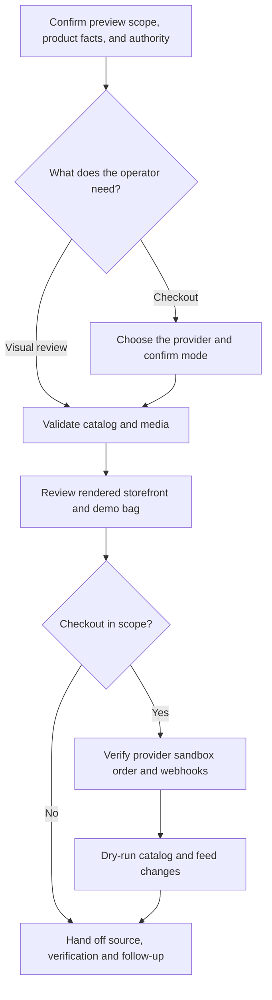

# Web Storefront Creator

Build a shop the customer can understand on a phone and the operator can maintain. Keep product facts, prices, variants and image attribution in a single catalog. Use the host site's visual language to make those facts easy to inspect and act on.

## Start when

- The business wants to add or improve an owned storefront, or has a catalog or preview ready to review.
- Identify the desired deliverable (design preview, sandbox checkout or production), the real catalog source, what the operator can change, and the host site's visual constraints.
- Get a representative product, its available variants and its intended price, plus verified media or permission to use clearly labeled illustrative media. If these are missing, make a clearly labeled fixture and state the data the operator must supply before publication.
- For sandbox or production commerce, identify the provider account, mode, currency and authorized operations before touching remote state. Start with reads and dry runs.

## Stop when

- **Preview complete** when a buyer can find a specified item, identify the price and variant, add or remove it from the demo bag, and see the resulting subtotal at 320 px and a desktop width. Verify keyboard access, 200% text, product imagery, missing-image behavior and reduced-motion behavior. Show which parts simulate production.
- **Sandbox complete** when a test purchase produces one order and one inventory change, a duplicate webhook changes neither, and failure and cancellation leave the buyer a recoverable path. A sandbox order does not prove a payout.
- **Production handoff** when the store operator has the route, catalog path, deployment or preview URL, checkout evidence and an edit → validate → dry-run → apply → verify walkthrough. The operator's first check is changing one agreed fixture price and comparing the storefront and provider read surface. Document payout evidence separately from checkout evidence.
- **Blocked** when a missing product fact, currency, provider access, permission or required commerce check affects accuracy. State the last verified state, the likely impact, the owner and exactly what would resume the work.

## Choose the route

Use for net-new or existing React/Tailwind/Radix storefronts, catalog-as-code, provider checkout and product feeds. Consult [platform landscape](references/platform-landscape.md) and current first-party provider documentation for fees, market coverage, tax responsibilities and checkout behavior. For enterprise replatforming, marketplace-only businesses, native in-app payments, crypto or restaurant POS, route to a more specialized workflow.

## Core Process



### Step 1 — Intake and route choice

Capture the buyer's most important decision, physical or digital delivery, variant count, existing site cues and operator workflow. Choose one provider route if payment is in scope. Make unit economics explicit for the user's order size using current official fees, currency, region, and fulfillment or tax responsibilities.

### Step 2 — Catalog before code

Start from `templates/catalog.example.json`. Preserve assigned SKUs and use integer cents. Put the governing product data in the catalog, including image descriptions and variation-level stock when it is known. Run the validator against the same image root the preview will use.

### Step 3 — Previews in the site's own style

Keep type, spacing, accessibility and media anchored to the host style. Use the real product asset before choosing card density or hero crop. Make product name, kind, price and action readable at first glance. Explain decisions like print dimensions, framing, or PDF delivery where they affect purchase. Load [storefront design and verification](references/storefront-design-and-verification.md) for primary design references, a responsive review sequence and deployable acceptance checks.

```bash
python3 scripts/extract_site_style.py https://their-site.com --out style-tokens.json
python3 scripts/validate_catalog.py catalog.json --images-root public
python3 scripts/render_storefront_preview.py catalog.json --style style-tokens.json --out preview/
```

Review the token extractor's heuristic output. For the bundled Cinder & Pine fixture, see [the runnable example](examples/preview/index.html) and [how to verify it](examples/preview/README.md). The demo bag runs in the browser and makes no checkout requests.

### Step 4 — Integration

Consult [React integration](references/react-integration.md). Keep card fields in the provider's supported secure checkout. Use stable variant IDs for line items and compute order price and availability from trusted data on the server. Verify webhook signatures using the raw payload. Persist idempotency with order and inventory updates so retry or concurrency cannot duplicate a side effect.

### Step 5 — Sync and feeds

Run `validate_catalog.py` and the provider sync's default dry run in the intended account. Review an exact SKU or price delta and apply only within the operator's authorization. Test a repeat to confirm there is no second change. Use `build_feed.py` for product feeds and compare at least one published item against the storefront. Consult [marketplace cross-listing](references/marketplace-crosslisting.md) for channel-specific coverage.

### Step 6 — Words and handoff

Lead with materials, size, delivery or licensing that a buyer can verify on the product's page. Edit copy for human specificity and leave ratings, discounts, scarcity, delivery claims and provenance out unless the operator has evidence. Resolve all applicable placeholders in the operator README, FAQ and update playbook. Link the exact catalog, dry-run instructions and checkout evidence or the reason they remain open.

## Anti-Patterns

### The Custom Card Form
**Novice**: "I'll build a nice card input with shadcn components so it matches the site."
**Expert**: Card fields must live in the processor's iframes (Stripe Elements/Checkout). A DIY form moves you from PCI SAQ-A (~nothing) to SAQ-D (a compliance project) and makes you a breach liability. Match the site via the Appearance API instead.
**Detection**: any `<input>` whose value is a PAN/CVC in your own JSX.

### Editing Prices In Place
**Novice**: "Just PATCH the Stripe price to the new amount."
**Expert**: Stripe Prices are immutable — amount/currency can never change. Create a new Price with `transfer_lookup_key=true`, archive the old. Corollary: archiving a price kills its Payment Links; regenerate them after any reprice.
**Timeline**: always true in Stripe; the 2025-07-30 API added inline `price_data` for links as mitigation.

### Platform Dashboard as Source of Truth
**Novice**: edits products in the Stripe/Shopify dashboard, then the website, then Etsy, by hand.
**Expert**: one catalog file in git; idempotent scripts fan outward. Hand-edits in three dashboards WILL diverge, and the operator inherits the mess. The dashboard is a read surface and refund tool, not an editor.

### Stale provider and tax assumptions

A search result or model answer may describe a retired API, outdated filing threshold, or channel that changed checkout terms. Verify fee, reporting and tax claims against the provider or authority for the actual region and date. Separate what the platform collects from what the operator still owes or must file.

### Non-Idempotent Webhook Stock Decrement
**Novice**: `quantity -= 1` in the webhook handler.
**Expert**: Provider webhooks retry and can arrive out of order. Store processed event IDs with the stock and order mutation, and reconcile against the latest authorized provider state.

### Potemkin Storefront
**Novice**: ships a beautiful product grid where Buy buttons don't charge, inventory is decorative, and no policy pages exist.
**Expert**: previews are explicitly labeled mockups; a shipped store must show the appropriate policies and verified payment and inventory behavior. Make preview boundaries visible before the operator tests a bag.

## Shibboleths

- **"Prices in cents, `lookup_key` as the handle"** — floats and hardcoded `price_xxx` IDs are the two tells of a first-time Stripe integration.
- **"Refunds and disputes have different operator consequences."** Verify current fee and status behavior in the provider account. Keep both paths in the runbook.
- **"Payment processing and merchant-of-record responsibility are different."** Verify eligibility, who issues invoices and who handles each jurisdiction’s tax or refunds.
- **"Use the fewest feeds that match current channel specs."** Validate sample items before assuming a second channel accepts the first channel's fields.
- **"The operator loop is: edit catalog → validate → dry-run → apply → verify."** If a change requires touching two systems by hand, fix the automation, not the docs.
- **"Channel ownership has consequences."** Check how operators edit or retire listings after an API or aggregator creates them.
- **"Checkout, settlement and bank receipt are separate evidence."** Record which one was verified.

## Bundle Contents

| Path | What it is |
|---|---|
| `scripts/validate_catalog.py` | Catalog linter: SKU/slug uniqueness, integer cents, variants, image existence. Run before every sync |
| `scripts/sync_stripe.py` | Idempotent catalog→Stripe sync (dry-run default, archive-and-create repricing, deterministic idempotency keys) |
| `scripts/build_feed.py` | Google Shopping XML feed from catalog — feeds Google Merchant Center + Meta |
| `scripts/extract_site_style.py` | Heuristic font/color/radius extraction from a URL or local CSS → style-tokens.json |
| `scripts/render_storefront_preview.py` | Reproducible HTML collection and detail pages with a local demo bag and optional authored palette |
| `assets/storefront.css` and `assets/storefront.js` | Renderer styling and demo functionality, injected into static HTML |
| `templates/catalog.schema.json` | JSON Schema for catalog.json |
| `templates/catalog.example.json` | Worked 3-product example (physical + variants + digital) |
| `templates/OPERATOR-README.template.md` | Owner's manual skeleton — fill every placeholder |
| `templates/FAQ.template.md` | Deep operator FAQ skeleton (money, taxes, disputes, disasters) |
| `templates/update-playbook.template.md` | Step recipes: reprice, add product, sale, sold-out, retire |
| `examples/style-tokens.example.json` | Reviewed palette, type, theme, and editorial asset choices for the sample storefront |
| `examples/preview/index.html` | Rendered collection, linked detail pages, and the example bag |
| `references/tool2vec-queries.json` | Positive usage sentences embedded for WinDAGs matching |
| `references/graft-evaluation.json` | Separate realistic positive and neighboring requests for routing checks |

All scripts are stdlib-only Python 3.10+; no pip installs. `sync_stripe.py` needs `STRIPE_API_KEY`.

## References (load on demand)

| File | Consult when |
|---|---|
| `references/storefront-design-and-verification.md` | Original design choices, current primary sources and exact behavior to inspect |
| `references/platform-landscape.md` | Choosing the route: full decision matrix, fees, MoR vs DIY, temporal traps |
| `references/react-integration.md` | Wiring checkout into React/Tailwind/Radix: Stripe/Shopify/Snipcart patterns, theming bridge, webhooks, CSP |
| `references/payments-banking-tax.md` | Bank linkage, sole-prop onboarding, 1099-K/SE tax numbers, sales tax posture, chargebacks, FTC rules |
| `references/catalog-inventory.md` | SKU schemes, Stripe price immutability mechanics, sync pattern, inventory webhooks |
| `references/marketplace-crosslisting.md` | Per-channel API reality, three-wave rollout, aggregator table, feed spec |
| `references/copywriting-product-pages.md` | Writing product copy + the make_copy_and_media_human handoff |
| `references/operator-handoff.md` | Standards for the README/FAQ/playbook deliverables and the update-system contract |

## Evidence to report

- Preview or release path and the actual catalog revision.
- Which product paths, variants, totals, keyboard and responsive states passed.
- Match and graft behavior for held-out requests if the WinDAGs vector changed.
- Sandbox order, retry behavior, live checkout and payout status as separate checks when relevant.
- Named operator, first verification step, and any missing authority or data that keeps the store in preview.
